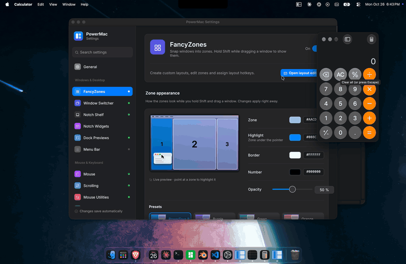
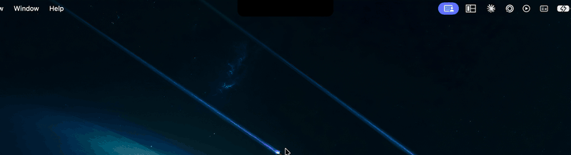
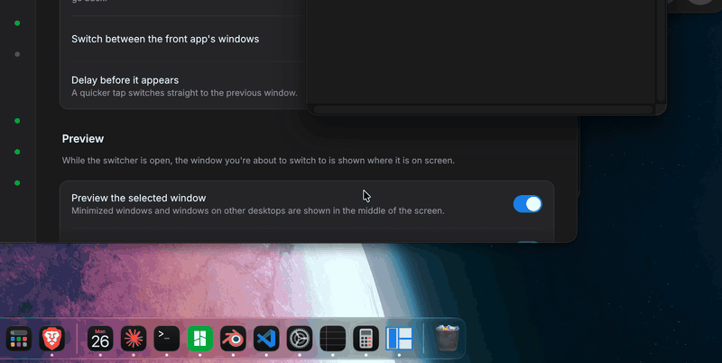
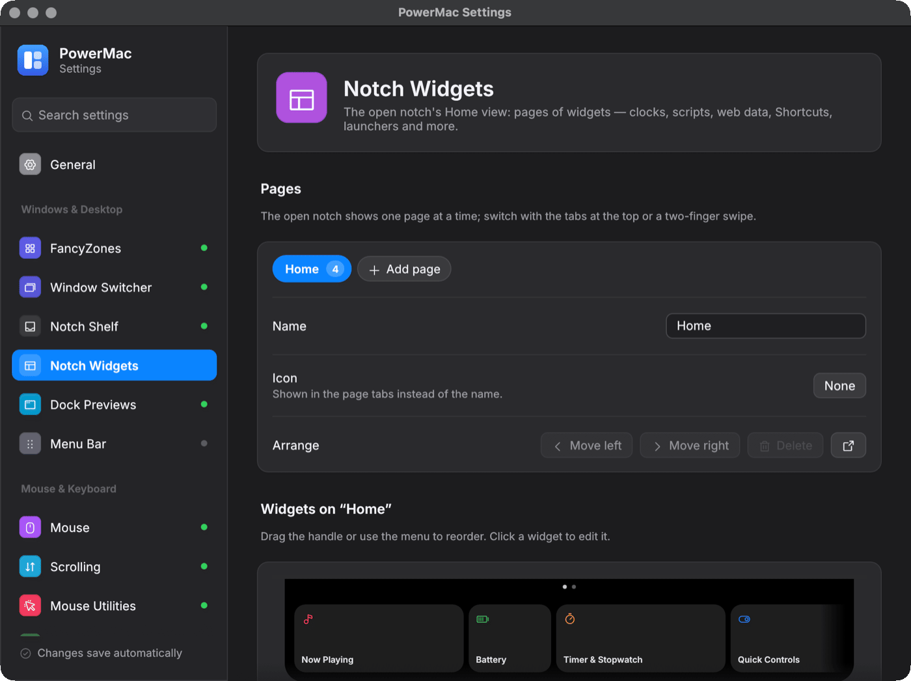
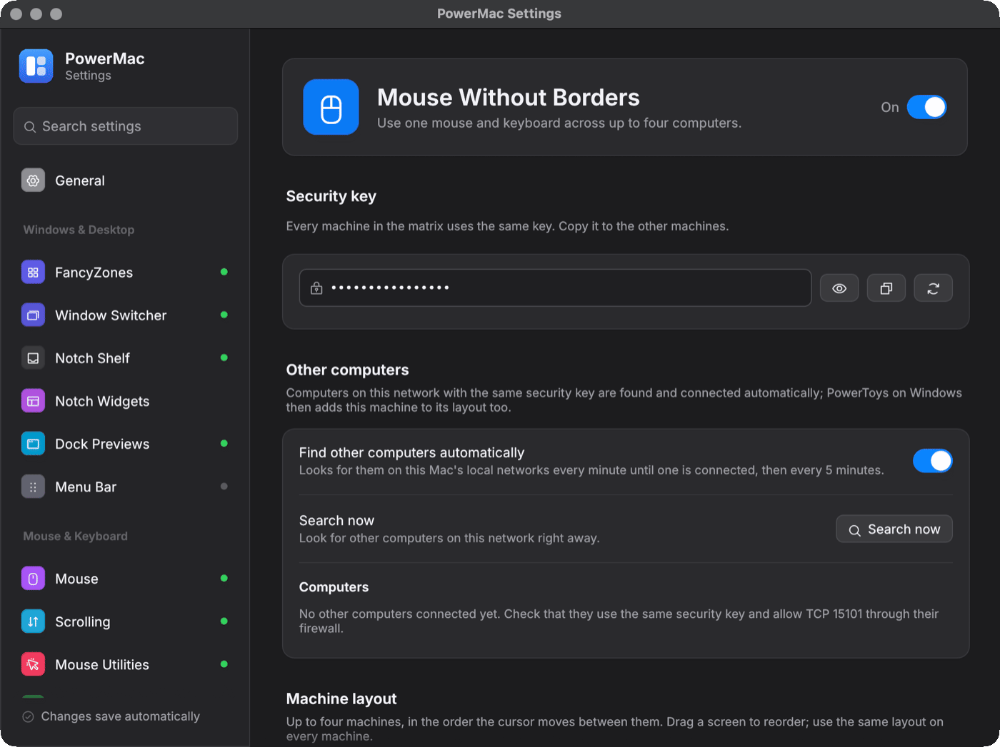
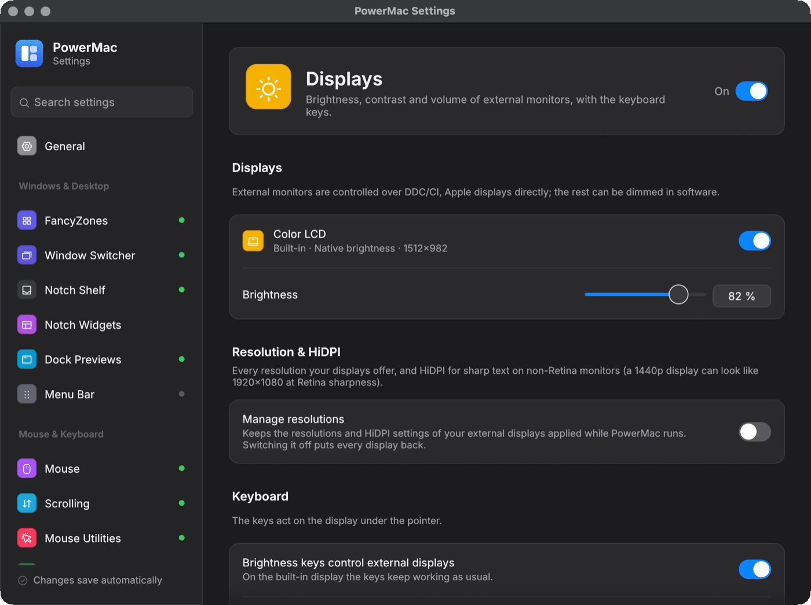
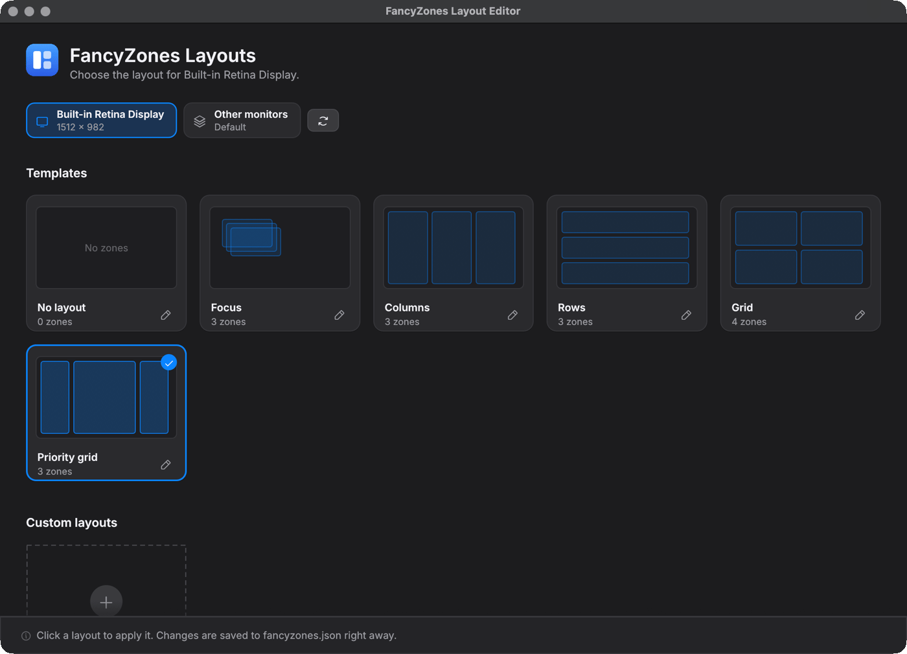

# PowerMac

A Rust port of PowerToys-style utilities that runs on **macOS and Windows**, as a menu-bar (macOS) or notification-area (Windows) app with a settings window.

<p align="center">
  
</p>

**Download:** the latest macOS build is on the [Releases page](https://github.com/finepointcgi/PowerMac/releases).

**Documentation:** https://finepointcgi.github.io/PowerMac/ — the full guide (every feature, its settings, the architecture and the release checklist) is in [`docs/`](docs/index.md) and is published as a site by GitLab Pages (`.gitlab-ci.yml`) or GitHub Pages (`.github/workflows/docs.yml`). Preview it locally with `pip install -r requirements-docs.txt && mkdocs serve`.

<table>
  <tr>
    <td></td>
    <td></td>
    <td></td>
  </tr>
  <tr>
    <td></td>
    <td></td>
    <td></td>
  </tr>
  <tr>
    <td></td>
    <td></td>
    <td></td>
  </tr>
</table>

| Module | What it does |
|---|---|
| **Mouse Without Borders** | Share one keyboard and mouse (plus clipboard text) across up to 4 machines. It is wire-compatible with Windows PowerToys MWB, so a Mac running PowerMac can join a matrix of PCs running PowerToys. |
| **FancyZones** | PowerToys FancyZones, with the same features on macOS:<br>• Layouts: Focus, Columns, Rows, Grid, Priority Grid, plus custom grid and canvas layouts you build in the **layout editor** (Ctrl+Option+`, or tray → FancyZones → Edit layouts…).<br>• Dragging: Shift+drag to drop a window into a zone; Ctrl or middle-click to span zones; scroll while dragging to switch layouts.<br>• Shortcuts: Ctrl+Option+Arrow snaps the focused window; Ctrl+Option+Cmd+0–9 switches layouts; Ctrl+Option+] and [ cycle the windows in a zone.<br>• Window handling: monitor rotation, excluded apps, separate layouts for each Space, windows kept in their zones when layouts or displays change, new windows placed in their app's last zone.<br>On Windows the shortcuts use Win in place of Ctrl+Option, as in PowerToys. |
| **Edge snapping** (Rectangle-style, part of FancyZones) | Drag a window to an edge to snap it: left/right edge for a half, top for maximize, bottom for the bottom half or thirds, corners for quarters. A preview shows first, and dragging the window out restores its size. On by default on macOS; off on Windows, which has its own Snap. |
| **Awake** | Keep the computer (and optionally the display) awake: indefinitely, for a set time, until a set time, or while a process runs. |
| **Window Switcher** | Windows-style Alt+Tab: Option+Tab cycles through **windows** (not apps) in most-recently-used order with live previews; Option+` cycles the front app's windows. Can also replace Cmd+Tab (one switch, or set its shortcut to Cmd+Tab; the macOS switcher comes back on quit, failure or after a crash) and previews the selected window in place while you switch. Q/W/M/H/F quit, close, minimize, hide or full-screen the selected window. |
| **Notch Shelf** | Turns the notch into a drop shelf: drag files, links, text or images to the top of the screen, park them, and drag them out again later. Macs without a notch can get a "virtual notch". The Home view is a **widget platform**: pages of cards in three sizes — Now Playing, Calendar, Weather, Battery, System Stats, Timer, Note, Mirror, Reminders, World Clocks, Bluetooth devices, Sound, **Quick Controls** (Awake, Pick color, Extract text, Clipboard history, Window switcher, Lock screen, Show desktop) and build-your-own **Script**, **xbar plugins**, **Web / JSON**, **Shortcuts** and **Launcher** widgets. Settings → **Notch Widgets** (tray → *Notch widgets…*) has a gallery, a generated settings form with a Test run, and layout export / import ([docs](docs/features/notch-widgets.md)). |
| **Drag Shelf** | Dropover-style floating shelves: while dragging files, links, text or images, **shake the pointer** and a shelf opens under it. Park the items, move between windows, Spaces and folders, then drag them out — all at once from the fanned stack, or one by one from the grid. Copy to… / Move to… a folder, Open, Show in Finder, Share (AirDrop), several shelves at once, empty shelves close by themselves; tray → **New drag shelf** and an optional shortcut. macOS only ([docs](docs/features/drag-shelf.md)). |
| **Workspaces** | PowerToys Workspaces: save the apps and windows on your screens (frames, displays, states, documents, optionally browser tabs) as a named workspace and restore it later — apps that aren't running are started and every window goes back where it was. Tray → **Workspaces** (one item per workspace, Capture desktop…, Edit workspaces…), Settings → Workspaces, an optional shortcut for the editor and `powermac workspace list\|capture\|launch\|edit`. Imports PowerToys' `workspaces.json`. |
| **Dock Previews** | Rest the pointer on a Dock icon and a panel shows that app's windows (live thumbnails); click one to bring it forward, W/M to close/minimize, scroll to cycle. Optionally, clicking the front app's icon minimizes or cycles its windows, like the Windows taskbar (macOS). |
| **Menu Bar** | Off by default. Hides menu bar icons behind a chevron (Ice/Bartender style), with an always-hidden section, show on hover, auto-rehide and a floating bar; warns about icons hidden behind the notch and moves icons between sections from Settings (macOS). |
| **Mouse** (mouse tuning) | Turn pointer acceleration off and set the speed, separately for mice and trackpads, with per-device overrides (macOS). Side buttons go back/forward; the middle and side buttons can be remapped to Mission Control, App Exposé, Launchpad, copy/paste or any shortcut. |
| **Scrolling** | Reverse the mouse wheel but keep natural scrolling on the trackpad, or any other combination (vertical and horizontal separately), plus **smooth scrolling** for mouse wheels with adjustable distance, duration, acceleration and easing curve. |
| **Mouse Utilities** | Find My Mouse (double-tap Left Ctrl for a spotlight), a click highlighter (Cmd/Win+Shift+H) and crosshairs (Cmd+Option+P / Win+Alt+P). |
| **Keyboard Manager** | Remap keys (e.g. CapsLock→Esc) and shortcuts (e.g. Ctrl+Left→Option+Left, optionally only in one app). A shortcut can also run a program, open a URL or type text. **Paste as plain text** is Cmd+Option+Shift+V (Win+Ctrl+Alt+V on Windows). **Caps Lock** can become a Hyper key (Ctrl+Option+Shift+Cmd), Control or Escape, with tap-for-Escape. **Windows-style keys** (macOS, off by default): Home/End, Ctrl+arrows, Ctrl+Backspace, and in Finder Cmd+X/Cmd+V to move files, Return to open, Delete to trash. |
| **Displays** | Brightness, contrast and volume of external monitors over DDC/CI (Apple Silicon; native brightness for Apple displays, software dimming for the rest). The brightness/volume keys act on the display under the pointer, with an on-screen level. Sliders in Settings and presets in the tray. |
| **Resolution & HiDPI** (Displays page) | Off by default. Every mode of every display, switched with a "keep this resolution?" countdown that reverts on its own; **HiDPI on non-Retina external displays** (a mirrored virtual display, so a 1440p monitor can look like 1920×1080 at 2×), custom "looks like" sizes, and an optional permanent display-override plist (admin). The chosen mode is remembered. |
| **Sound** | Preferred output / microphone priority lists, a "never switch to automatically" list (AirPods), keep the built-in mic with Bluetooth headphones, and **per-app volume** (experimental on macOS 14.4+, needs System Audio Recording). **App routing** sends an app to other speakers or a virtual device (only there, or as well), and the **Mixer** page mixes apps, microphones and virtual devices into any output with faders, mute/solo, a send matrix, per-strip EQ and limiter and live meters ([docs](docs/features/audio-routing-mixer.md)). Ships the **PowerMac Audio** virtual device (installed only on request). Tray: Sound menu with devices and per-app presets. |
| **Battery** | Health, cycles and temperature, and an AlDente-style **charge limit** with sailing, heat protection, discharge to the limit and charge-to-full-once. Settings explains this Mac's strategy (charge inhibit, firmware range or limit via discharge) before you turn it on and shows macOS's own Charge Limit. Writing the SMC needs a small helper that is only installed when you click **Install helper…** ([docs](docs/features/battery.md)). |
| **Automation** | Hotkeys, mouse buttons and **trackpad gestures** (3–5-finger swipes, taps, clicks, pinches; record one from Settings) that run **shell commands or scripts** (interpreter, working folder, environment, wait or background, time limit, notifications, per-action logs), open apps and URLs, type text or press shortcuts, optionally only in one app; a Test button shows the output ([docs](docs/features/automation.md)). |
| **Text Expansion** | Off by default. Type an abbreviation (`;date`, `btw`) anywhere and it becomes its snippet, with variables (`{date}`, `{clipboard}`, `{cursor}`, …), per-app snippets, Backspace to undo, excluded apps, and espanso import. |
| **Clipboard History** | Off by default. Everything you copy (text, rich text, images, files), searchable in a picker on Cmd+Shift+V (Win+Shift+V); pin items, paste again. Password managers' concealed items and excluded apps are never recorded. The tray lists the 10 most recent items. |
| **Color Picker** | Ctrl+Option+C (Win+Shift+C) picks a color anywhere on screen and copies it as HEX, RGB, HSL, … or a custom format; the editor shows history, variations and every format. |
| **Text Extractor** | Ctrl+Option+T (Win+Shift+T): drag over any part of the screen and the text in it is copied (Vision OCR on macOS, Windows.Media.Ocr on Windows). |
| **Network Monitor** | Little Snitch / Radio Silence-style: Settings → **Network** (tray → Network activity…) and `powermac net list` / `watch` show every app's live TCP/UDP connections (grouped by app bundle, with direction and local/internet scope; read-only), and per-app **firewall rules** (allow / deny / ask by app, host, domain, address, network, port, protocol and direction; most specific wins; Little Snitch `.lsrules` import) live in `net-rules.json`. The rules are a model: `powermac net audit` shows what they would do, but nothing is blocked yet ([docs](docs/features/network-monitor.md)). |
| **File Tools** | **PowerRename** (bulk rename with search/replace, regex and previews), **New+** (new files and folders from your templates), **Image Resizer** and the **Finder basics**: Open in Terminal / Editor, Copy Path, Eject all drives, show hidden files, what is using a file. All from Finder Quick Actions (Explorer context menu on Windows) once installed from Settings → File Tools or the tray. |

## Install

Download `PowerMac-<version>-macos-<arch>.dmg` from [Releases](https://github.com/finepointcgi/PowerMac/releases), open it and drag PowerMac onto Applications.

The app isn't notarized by Apple (there is no paid developer account behind it), so on a Mac other than the one that built it, the first launch is blocked: open PowerMac once, click **Done**, then go to **System Settings → Privacy & Security**, scroll to **Security** and click **Open Anyway** next to the PowerMac message (or run `xattr -dr com.apple.quarantine /Applications/PowerMac.app`). Later launches open normally.

On first launch a short **setup** walks through what PowerMac does, which feature groups to turn on, and the permissions they need — each with its live status, a button that opens exactly the right System Settings pane, and a **Restart PowerMac** button, because macOS gives Input Monitoring and Screen Recording only to a freshly started app. It's in the menu as **Setup & permissions…** whenever you need it again.

PowerMac checks GitHub once a day for a newer release and offers it in the menu and in Settings → General (notes and a Download button; nothing is installed by itself). Turn it off there or with `"updates": {"check": false}`.

## Quick start from source (macOS)

```bash
./scripts/bundle-macos.sh                # builds target/release/PowerMac.app
open target/release/PowerMac.app         # or move it to /Applications first
./scripts/package-dmg.sh                 # PowerMac-<version>-macos-<arch>.dmg (+ .sha256)
```

The first launch creates a config with a new Mouse Without Borders key and opens the setup. Everything else is in the tray menu: **Settings…**, **Setup & permissions…** (a **⚠ Needs …** line and a dot on the icon while a permission is missing; **Update available** when there is one), **Workspaces**, Awake modes, FancyZones layouts, scroll direction, mouse utilities, Paste as plain text, Copy security key, Launch at login, **Sound** (output and input devices, per-app volume presets), and a **Tools** section: Pick color, Extract text, Clipboard history (picker, recent items, pause, clear), Window switcher, Show shelf, Displays (brightness/volume presets per external display), Show hidden menu bar items, the Finder Quick Actions switch, Eject all drives and Show hidden files.

### Command line

```bash
cargo build --release
./target/release/powermac            # same as `run`: all enabled modules + tray icon
./target/release/powermac settings   # the settings window
./target/release/powermac doctor     # config, permissions, screens
./target/release/powermac init       # write a fresh config.json and print the key
./target/release/powermac awake --display-on --time-limit 3600
./target/release/powermac clipboard              # the clipboard history picker
./target/release/powermac color-picker           # pick a color, copy + print it (--editor: the editor)
./target/release/powermac ocr shot.png           # text in an image (--clipboard: the clipboard image; neither: select on screen)
./target/release/powermac rename a.jpg b.jpg     # PowerRename (what the Finder Quick Action runs)
./target/release/powermac new --dir ~/Desktop    # New+ (what the Finder Quick Action runs)
./target/release/powermac resize --size 50% *.jpg  # Image Resizer (without a size option: its window)
./target/release/powermac finder eject-all       # also open-terminal, copy-path, show-hidden, who-uses, … (no arguments: help)
./target/release/powermac workspace list         # also capture [NAME], launch NAME|ID, edit
./target/release/powermac net list               # every app's connections (also watch, audit, rules …)
./target/release/powermac permissions            # each permission, its state and who uses it (--json)
./target/release/powermac update check           # ask GitHub for a newer release (nothing is installed)
./target/release/powermac mwb doctor             # pairing diagnostics for Windows PCs
./target/release/powermac --version
```

Config lives at `~/Library/Application Support/PowerMac/config.json` (`%APPDATA%\PowerMac\config.json` on Windows), with FancyZones layouts in `fancyzones.json` and PowerRename/New+ settings in `file-tools.json` next to it. Changes take effect within about a second, whether they come from the settings window, the tray or a text editor. Config files from older versions keep loading; new sections get their defaults. The same folder holds the clipboard history (`clipboard/`), the notch shelf, the color history, and `display-status.json` / `display-set.json`, through which the settings window (a separate process that never talks to the monitors itself) shows and changes display values via the running app. Resolution & HiDPI, Sound, Menu Bar and the notch widgets work the same way (`display-scaling-status.json` / `-request.json`, `audio-…`, `menubar-…`, `notch-…`: widget results, reminder lists, refresh / show-page requests), and `settings-request.json` lets the tray switch an open settings window to a page; `display-scaling-state.json` records what Display Scaling changed, so a crash is undone on the next start.

The settings window checks shortcuts across all modules and won't save two modules on the same keys.

### Pairing with Windows PowerToys

1. In PowerToys → Mouse Without Borders on the PC, copy its security key and machine name. You can also go the other way: use **Copy security key** in the PowerMac tray and paste it into PowerToys.
2. In Settings → Mouse Without Borders, enter the key. With **Find other computers automatically** on (the default), PowerMac probes TCP 15101 on the hosts of this Mac's private subnets (at most 1024 per network, the /24 around the Mac on larger ones) every minute until a machine is connected, then every 5 minutes, or right away with **Search now** / tray → **Find computers now**. A machine that completes the key handshake is connected, put to the right of this Mac in the layout, and its address is saved; PowerToys then adds the Mac to its own layout. A machine with a different key is left alone for 30 minutes. Otherwise put both machines in the matrix in left-to-right order, and if the PC's name doesn't resolve, add a peer address such as `192.168.1.20`.
3. Allow TCP **15101** through the firewall on the machine that accepts the connection. From the PC, use PowerToys' **Connect** with the Mac's **name** (not its IP address). PowerMac answers Windows' LLMNR name queries for it. If pairing fails, run `powermac mwb doctor` and see [Pairing with a Windows PC](docs/features/mouse-without-borders-pairing.md).
4. "Swap Cmd/Ctrl" (on by default on macOS) makes Cmd+C on the Mac arrive as Ctrl+C on Windows, and the other way round.

### macOS permissions

| Permission | Needed by |
|---|---|
| **Accessibility** | Mouse Without Borders, FancyZones, Scrolling, Mouse Utilities, Keyboard Manager (incl. Caps Lock and automation hotkeys), Window Switcher, Clipboard History's hotkey, Mouse button mappings, keeping bound trackpad clicks from apps, Displays' brightness/volume keys, Dock Previews, Text Expansion, Menu Bar (moving icons from Settings; listing other apps' icons on macOS 26) |
| **Input Monitoring** | Mouse Without Borders, FancyZones, Mouse Utilities, Keyboard Manager |
| **Screen Recording** | Text Extractor (capturing the screen; files and clipboard images work without it), Window Switcher and Dock Previews thumbnails (app icons are shown without it), Menu Bar's floating bar images on macOS 15 and older |
| **System Audio Recording** | Sound → per-app volume, app routing and the mixer's app sources (Core Audio process taps; asked from Settings → Sound) |
| **Microphone** | The mixer's microphone and interface sources (asked the first time the mixer opens one) |
| **Calendars** | Notch Shelf's Calendar widget (asked the first time it's shown) |
| **Reminders** | Notch Shelf's Reminders widget (asked the first time it's shown) |
| **Camera** | Notch Shelf's Mirror widget (asked when you click it) |
| **Automation** | Notch Shelf's "Read Music and Spotify directly" (asked once per app); File Tools' "Use the front Finder window" (Finder) |
| **Administrator password** (once each, only on request) | Resolution & HiDPI's optional permanent display override (a plist in /Library/Displays); the battery charge-limit helper (Settings → Battery → Install helper…); the PowerMac Audio driver (Settings → Sound) |
| none | Color Picker (system loupe, Carbon hotkey), Notch Shelf, Displays sliders, resolutions and HiDPI, Sound's device rules, pointer speed/acceleration, File Tools |

The setup and **Settings → General → Permissions & Health** show their live status (with the exact System Settings pane for each), the shared input hook's health and whether each module runs or waits for a permission. A module whose permission is missing waits for it and keeps the rest of PowerMac running.

macOS ties these grants to the app's code signature. Run `scripts/create-signing-cert.sh` once so local builds keep their grants; otherwise, after rebuilding `PowerMac.app`, remove the old PowerMac entry with **−** and add the new app with **+** (the setup shows these steps when it detects an outdated entry), then restart PowerMac.

## Layout

```
crates/pm-hook           the one global input hook (CGEventTap / LL hooks) all modules subscribe to, in priority order
crates/pm-input          Mouse Without Borders' input capture (via pm-hook) and injection (CGEventPost / SendInput), VK keymaps
crates/mwb               MWB protocol (packets, PBKDF2 + AES-256-CBC, handshake), engine, C# interop harness
crates/fancyzones        zone math, edge snapping, config (imports FancyZones JSON), AX / Win32 backends, overlay
crates/awake             IOPMAssertion / SetThreadExecutionState controller
crates/scroll-reverser   trackpad-vs-mouse classification and wheel reversal
crates/mouse-utils       Find My Mouse, highlighter, crosshairs (Core Animation / layered-window overlays)
crates/keyboard-manager  remap state machine, paste as plain text, Windows-style keys preset, PowerToys default.json importer
crates/mouse-tuning      pointer acceleration / speed (HID event system, SPI_SETMOUSE), button remapping
crates/display-control   DDC/CI, native and gamma brightness, media-key takeover, OSD
crates/clipboard-history clipboard watcher, history store, picker (egui, own process)
crates/notch-shelf       the notch drop shelf (NSPanel / layered window)
crates/color-picker      NSColorSampler / magnifier pick, PowerToys color formats, editor
crates/text-extractor    region capture + Vision / Windows.Media.Ocr
crates/file-tools        PowerRename, New+, Finder Quick Actions / Explorer verbs
crates/window-switcher   Alt+Tab-style window switcher (event tap, CGWindowList, overlay)
crates/display-scaling   display modes with revert timer, HiDPI via CGVirtualDisplay mirroring, override plists
crates/audio-control     default-device rules, device levels, per-app volume (process taps / audio sessions)
crates/dock-previews     window previews on Dock icons (AX tree, ScreenCaptureKit, NSPanel)
crates/text-expander     abbreviation expansion (event tap / LL hook), variables, espanso import
crates/menubar-manager   hide menu bar icons behind separators, notch detection, floating bar
crates/pm-ui             shared egui theme and widgets
crates/workspaces        capture / restore desktops of apps and windows, the Workspaces editor
crates/net-monitor       per-app TCP/UDP connection monitor (libproc / IP Helper), firewall rules model, .lsrules import
crates/pm-update         update check against GitHub Releases (semver, once a day, via curl)
crates/pm-config         the shared config.json model, status/request files, launch-at-login
crates/settings-ui       egui settings window (runs as `powermac settings`)
crates/powermac          the app: tray, module lifecycle, config reload, clipboard bridge
```

## Testing

`cargo test --workspace` runs about 800 tests. `PM_UI_SHOTS=<dir> cargo test -p settings-ui shots` renders every settings page (light and dark) to PNGs. `crates/mwb/tests/interop.rs` builds a .NET harness from PowerToys' own encryption and packet code (it needs `dotnet`). That harness checks byte-for-byte test vectors and runs live TCP sessions in both directions.

On a Mac with permissions granted, these were also run live:
- Input capture and injection.
- Edge snapping (halves, quarters, maximize), Shift+drag into zones and Ctrl+Option+Arrow, on a real TextEdit window.
- The real app connecting to the C# peer. Hitting the screen edge switched control and forwarded moves and the scroll wheel; moving back across the edge returned control.
- Scroll reversal of real scroll events.
- Remapping harmless F13–F20 keys.
- Awake power assertions, checked with `pmset`.

## Known gaps

- **Windows:** every crate is compile-checked (`cargo check --target x86_64-pc-windows-msvc`) but none has been run on Windows yet.
- **Mouse Without Borders:** no file transfer, drag-and-drop or clipboard images; clipboard text works. About 1 in 512 keys trips a C# quirk that makes Windows MWB reject every packet; PowerMac warns about it, and you should generate a new key if you see the warning.
- **Scroll Reverser on Windows:** it can't tell a touchpad from a mouse, so the mouse settings apply to all wheel input. There is an optional heuristic.
- **Keyboard Manager:** no two-step chords and no PowerToys "alone" remaps. CapsLock works as a tap only on macOS.
- **Other window snappers:** quit Rectangle (or turn off its edge snapping) and leave macOS's "Drag windows to screen edges to tile" off; otherwise windows get snapped twice.
- **FancyZones on macOS:** a dragged window can't be made see-through (macOS offers no API for that). Zone assignments are kept in memory, so they're lost when PowerMac restarts. 
- **Displays:** DDC/CI is implemented for Apple Silicon Macs; on Intel Macs only native and software brightness work.
- **Resolution & HiDPI:** HiDPI uses the private `CGVirtualDisplay` API (macOS 11+); while it's on, the display shows up as "<name> (HiDPI)" and FancyZones keeps a separate layout for it. The permanent override needs a reconnect or restart. On Windows only modes are offered (Windows scales text itself).
- **Sound:** per-app volume on macOS is experimental (process taps, macOS 14.4+); levels are kept per bundle id.
- **Text Expansion / Settings:** characters the bundled fonts lack (e.g. the ツ in the default `;shrug` snippet) are drawn as boxes in the settings window; they expand correctly.
- **Menu Bar:** moving icons from Settings synthesizes a Cmd-drag and needs Accessibility; Cmd-dragging them yourself always works. Only one manager per process.
- **Not ported yet:** Mouse Jump, Always On Top.
- **Network Monitor:** the firewall rules aren't enforced (that needs a Network Extension content filter, an Apple paid-program entitlement, or WFP on Windows); the monitor polls the socket table, so very short connections can be missed, and host/domain rules only apply where a host name is known.
- **Distribution:** releases aren't notarized (see Install); updates are offered, not installed.
