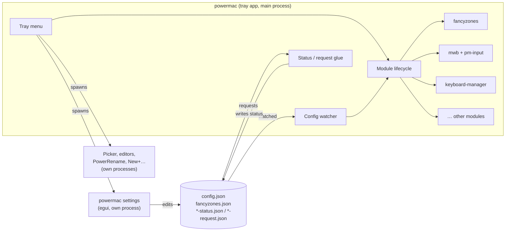

# Architecture overview

## Principles

- **One crate per feature.** Each module is a library crate with a `Config` (serde, camelCase, every field optional), a `start(config) -> Handle`, live `update`, and `stop` that restores whatever it changed.
- **Pure core, thin backends.** Geometry, state machines, parsers and policies are platform-independent and unit-tested (about 550 tests). OS code lives under `platform/macos` and `platform/windows` and is as small as possible.
- **Windows semantics as the lingua franca.** Keys are Windows virtual-key codes everywhere, so configs and the Mouse Without Borders wire format are the same on both platforms.
- **The main thread belongs to AppKit.** On macOS every overlay and panel is created on the main thread through the main dispatch queue; the tray app runs `NSApplication` there. Event taps and workers run on their own threads.
- **Files, not sockets, between processes.** The settings window and helper windows are separate processes of the same executable and only exchange JSON files with the app (see [Process model and IPC](ipc.md)). The clipboard picker is the exception: it uses loopback TCP for speed.
- **Tagged synthetic input.** Every module that injects events tags them, and every tap skips tagged events, so modules never react to each other.

## The app crate

`crates/powermac`:

| File | Role |
|---|---|
| `main.rs` | CLI (clap), logging, startup, shutdown order |
| `modules.rs` | Starting, stopping and live-reconfiguring modules from `AppConfig` |
| `tray.rs` | Menu-bar / notification-area icon and menu |
| `children.rs` | Helper windows as child processes (one per slot; asking again brings it to the front) |
| `clipboard.rs` | Bridge between the system clipboard and Mouse Without Borders |
| `*_glue.rs` | Status / request files for MWB, Displays, Display Scaling, Sound, Menu Bar |
| `quick.rs` | Notch Shelf quick controls |

## Config reload

A watcher polls `config.json` and `fancyzones.json`. On change it loads the new `AppConfig`, diffs each section, and calls `update` on running modules, `start` on newly enabled ones and `stop` on disabled ones. Changes apply within about a second.
