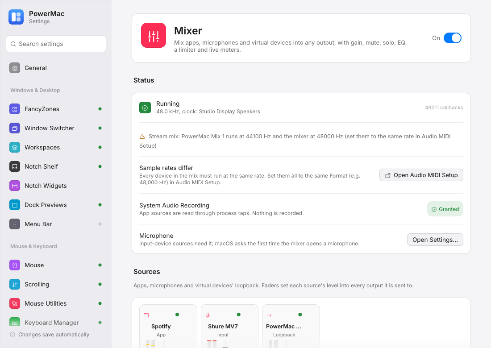

# App routing and the mixer

Send an app to other speakers or a virtual device, and mix apps, microphones and virtual devices into any output with gain, mute, solo, EQ, a limiter and live meters — like SoundSource and Loopback.

Crate: `crates/audio-control` (`mixer`) · Settings: **Sound → App routing**, **Mixer** page · Config: `audio.appRoutes`, `audio.mixer` · macOS 14.4 or later for app audio

<figure markdown="span">
  { loading=lazy }
  <figcaption>Sources and outputs with meters, the send matrix, and a strip's EQ and limiter.</figcaption>
</figure>

## App routing

Settings → Sound → **App routing** → *Add an app…* (apps playing sound are listed first). For each route:

- **Plays on** — one or more output devices, real ones or PowerMac virtual devices.
- **Normal output** — *Only there* (default: the app is heard only on the devices above) or *Also keep it* (it keeps playing where it did too).
- **Level** — extra gain on the routed sound (dB).
- A status line: *Routing now*, *Waiting: …* (the app isn't running, a device isn't connected) or *Unavailable: …*. A route comes back by itself when its app restarts or its device reconnects.

On Windows a route uses the system's per-app device setting (one device, no gain, no *Also keep it*).

## The mixer

The **Mixer** page (Displays & Power; `powermac settings --page mixer`) has its own switch.

- **Sources**: apps (process taps), microphones and interfaces (needs the Microphone permission), and virtual devices' loopback (what apps play to PowerMac Audio, BlackHole, …). Each strip has a fader (−60 … +12 dB; double-click resets to 0), mute, solo (while any source is soloed only soloed sources are heard) and a stereo meter (RMS bar, peak line, a red cap after clipping; hover for the values and the limiter's gain reduction).
- **Outputs**: devices the mix plays on, each with a master fader, mute and meter. The first connected output's clock drives the mixer; Core Audio keeps the others in step (drift compensation).
- **Sends**: a sources × outputs grid. Click a crosspoint to connect it, click again to disconnect; drag its value to set the send level in dB.
- **FX** on a strip opens its effects: input trim, a parametric **EQ** of up to 10 bands (bell, shelves, low/high-pass, notch; drag a point on the response curve or edit frequency, gain and Q) and a look-ahead **limiter** (ceiling, release, look-ahead). Sources also have *keep it on its normal output too*, first channel and mono.
- **Status**: running, sample rate and clock device, and why a strip is waiting or unavailable. When devices run at different sample rates the page says so and offers **Open Audio MIDI Setup**.

Gain, mute, solo, send, EQ and limiter changes are applied at once without interrupting audio (the settings window sends `AudioRequest::SetMixer`, at most every 70 ms while dragging); adding or removing strips rebuilds the mixer device, which causes a short gap.

### Meters

While the Mixer page is open the settings window renews `audio-watch.json` every second; while that is fresh the app writes `audio-meters.json` (`Handle::meters`) every 50 ms and the window reads it at the same rate. Nothing is written at 20 Hz otherwise.

## Settings

```json
"audio": {
  "appRoutes": {
    "com.spotify.client": { "enabled": true, "name": "Spotify", "outputs": [{"uid": "…", "name": "AirPods Pro"}], "keepDefault": false, "gainDb": 0 }
  },
  "mixer": {
    "enabled": true,
    "sources": [
      { "id": "src1", "name": "Spotify", "kind": {"type": "app", "bundleId": "com.spotify.client"}, "gainDb": -6, "muted": false, "solo": false,
        "keepOriginal": false, "firstChannel": 0, "mono": false,
        "effects": { "gainDb": 0, "eq": {"enabled": false, "bands": []}, "limiter": {"enabled": false, "ceilingDb": -1, "releaseMs": 100, "lookaheadMs": 5} } },
      { "id": "src2", "name": "Shure MV7", "kind": {"type": "input", "device": "Shure MV7"}, "mono": true }
    ],
    "outputs": [ { "id": "out1", "name": "Stream", "device": {"uid": "PowerMacAudio:mix1", "name": "PowerMac Mix 1"}, "gainDb": 0 } ],
    "sends": [ { "source": "src1", "output": "out1", "gainDb": -9, "muted": false } ]
  }
}
```

Everything is optional and empty / off by default; configs written before routing existed load unchanged. Routes and the mixer changed through the running app (`Handle::set_route` / `set_mixer`) are saved back into these keys a moment after the last change.

## Permissions

- **System Audio Recording** (`Privacy_AudioCapture`) for app sources and routes — shown on the routing card and the Mixer page, with **Open Settings…** when it's missing. Nothing is recorded.
- **Microphone** (`NSMicrophoneUsageDescription`) for input-device sources; macOS asks the first time the mixer opens a microphone.

## How it works

Routes and the mixer compile into one topology: a process tap per app (muted when the app should only be heard through the mix) and one private aggregate device whose clock is the first output, with the other devices as drift-compensated sub-devices. A single IOProc runs the graph. The topology is re-planned when devices, defaults or audio processes change. See the `audio_control::mixer` docs for the details.
