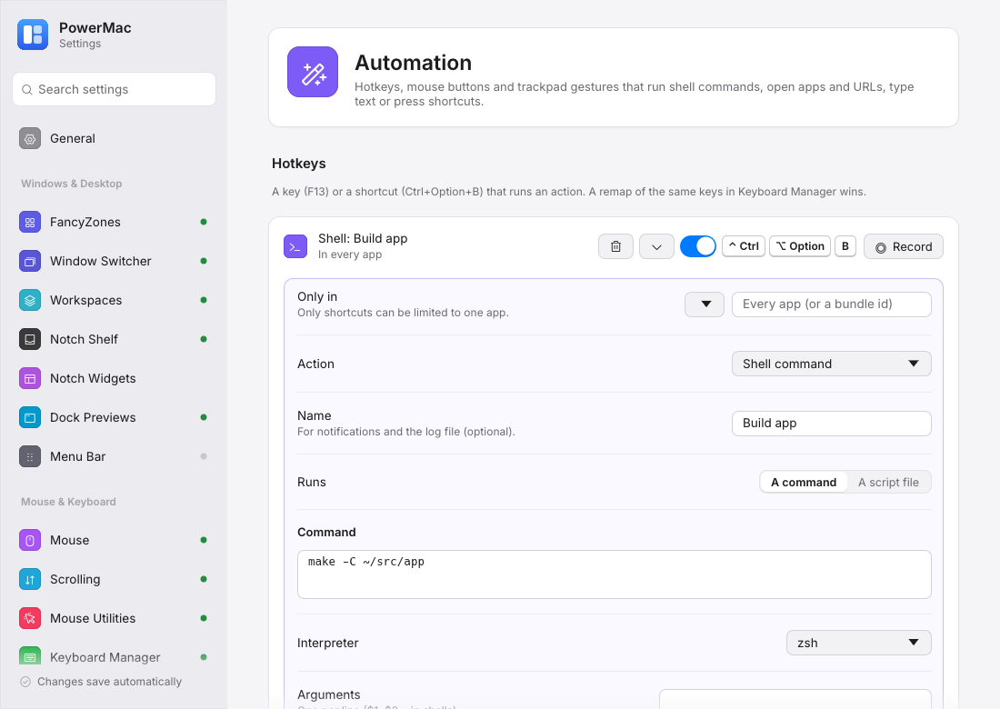

# Automation: hotkeys, mouse buttons and gestures

Run shell commands and scripts, open apps and URLs, type text, press shortcuts or paste as plain text — from a hotkey, a mouse button or a trackpad gesture (BetterTouchTool-style).

Crates: `crates/keyboard-manager` (`automation`), `crates/mouse-tuning`, `crates/gestures` · Settings page: **Automation** (Mouse & Keyboard) · Config: `keyboardManager.hotkeys`, `mouseTuning.buttons`, `gestures`

<figure markdown="span">
  { loading=lazy }
  <figcaption>Hotkeys with the action editor and a test run, mouse buttons and trackpad gestures.</figcaption>
</figure>

## Actions

Every trigger runs the same kind of action, edited with the same editor:

| Action | JSON |
|---|---|
| Do nothing | `{"type": "disabled"}` |
| Press a shortcut | `{"type": "shortcut", "keys": "Cmd+Shift+T"}` |
| Type text | `{"type": "text", "text": "ls -la\n"}` |
| Open an app / program | `{"type": "run", "path": "/Applications/Notes.app", "args": [], "workingDir": null}` |
| Open a URL, file or folder | `{"type": "openUri", "uri": "https://example.com"}` |
| Paste as plain text | `{"type": "pastePlainText"}` |
| Shell command | `{"type": "shell", "command": "make", …}` |

**Shell commands**: an inline command or a script file, the interpreter (zsh, bash, sh, Python 3, AppleScript, PowerShell, or a custom program), arguments, working folder (default: home), extra environment variables, *in the background* or *wait for it*, a time limit (waited commands default to 30 s), notifications (never / on failure / always, shown by the app) and output logging to `~/Library/Logs/PowerMac/actions/<name>.log` (**Open log**). Only commands you configured are ever run.

**Test** runs the action right away from the settings window (shell commands are waited for) and shows the result line and the captured output.

## Hotkeys

A single key (`F13`) or a shortcut (`Ctrl+Option+B`) that runs an action on each press (not on auto-repeat) and is swallowed. Shortcuts can be limited to one app. Hotkeys run while **Keyboard Manager** is on, take part in the global shortcut check (a shortcut used by another module is reported and not saved), and a remap of the same keys in Keyboard Manager wins.

```json
"keyboardManager": {
  "hotkeys": [
    { "from": "Ctrl+Alt+B", "action": { "type": "shell", "command": "make", "workingDir": "~/src", "wait": true, "notify": "onFailure" } },
    { "from": "F13", "action": { "type": "openUri", "uri": "https://example.com" } },
    { "from": "Cmd+Shift+L", "app": "com.apple.Terminal", "action": { "type": "text", "text": "ls -la\n" }, "enabled": false }
  ]
}
```

## Mouse buttons

The middle and side buttons can run any action too (`mouseTuning.buttons.mappings[].action` is either a built-in choice such as `{"type": "missionControl"}` or an action from the table). They work while the **Mouse** module is on and need Accessibility.

## Trackpad gestures

Three-, four- and five-finger swipes (left/right/up/down), taps and clicks, and two- to five-finger pinches. **Record gesture** asks the running app to read the trackpad; perform the gesture and it is added (or, from a binding's *Record…*, replaces that binding's gesture). Bindings can be limited to one app; an app-scoped binding wins over a global one, and *Do nothing* turns a global binding off in an app.

- Touches are only **read** (MultitouchSupport), never taken away from macOS, so macOS's own gestures for the same fingers (Mission Control, Spaces, Launchpad, Look up, three-finger drag) **also happen**. Such bindings are marked *macOS uses it too*, with a link to Trackpad settings; turn the macOS gesture off there if you only want yours.
- N-finger **clicks** can be kept from the app under the pointer (`swallowClicks`, via the shared input hook at priority 650; needs Accessibility).
- With nothing bound the trackpad isn't read at all. If the framework can't be loaded the page shows **Unavailable** with the reason and the rest of PowerMac is unaffected. macOS only.

```json
"gestures": {
  "enabled": true,
  "swallowClicks": true,
  "bindings": [
    { "gesture": "3-finger-tap", "action": { "type": "shortcut", "keys": "Cmd+W" } },
    { "gesture": "4-finger-swipe-down", "action": { "type": "shell", "command": "pmset displaysleepnow" } },
    { "gesture": "3-finger-click", "app": "com.google.Chrome", "action": { "type": "shortcut", "keys": "Cmd+Shift+T" } }
  ]
}
```

### Recording through the app

The settings window is a separate process, so recording goes through two files next to `config.json`: it writes `gestures-request.json` (`{"action": "record", "on": true}`, renewed every 2 s while recording; recording stops by itself 6 s after the last renewal) and reads `gestures-status.json`, which the app rewrites every 2 s and right after a recorded gesture (state, trackpads, the click watcher's error, the recorded gestures).
