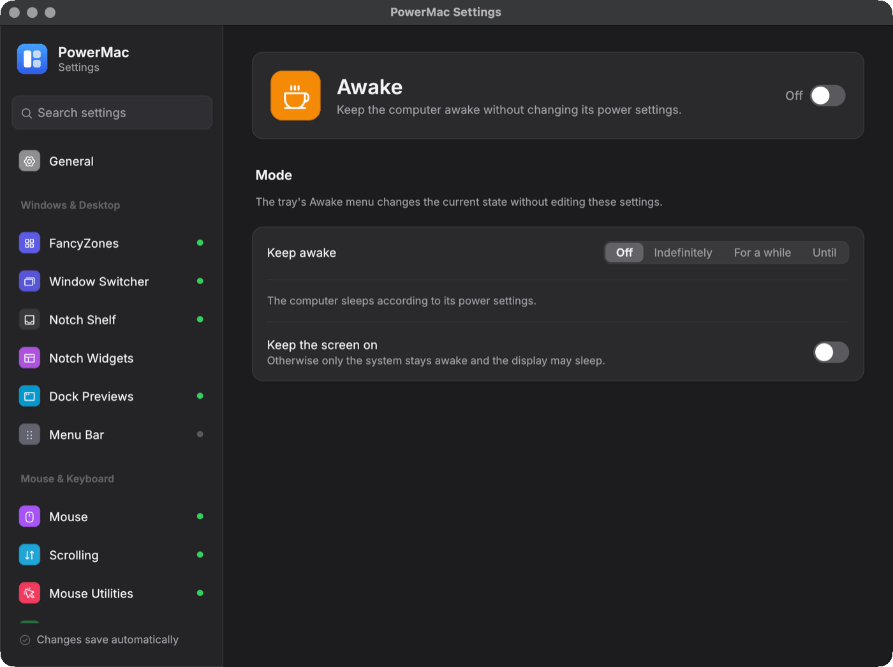

# Awake

Keep the computer (and optionally the display) awake. A port of PowerToys Awake.

Crate: `crates/awake` · Settings page: **Awake** · Config: `awake` · tray: **Awake** submenu

<figure markdown="span">
  { loading=lazy }
  <figcaption>The Awake settings page.</figcaption>
</figure>

## Modes

| Mode | JSON |
|---|---|
| Off (normal power plan) | `{"type": "passive"}` |
| Indefinitely | `{"type": "indefinite"}` |
| For a set time | `{"type": "timed", "value": 3600}` (seconds) |
| Until a set time | `{"type": "expirable", "value": "2026-10-26T18:00:00+01:00"}` |

`keepDisplayOn` also stops the display from sleeping. `boundPid` ends the mode when that process exits (whichever comes first).

```json
"awake": { "enabled": true, "mode": { "type": "timed", "value": 3600 }, "keepDisplayOn": true }
```

## Command line

```bash
powermac awake --display-on --time-limit 3600
powermac awake --expire-at 18:30
powermac awake --pid 4242
```

## How it works

- macOS: IOKit `IOPMAssertionCreateWithName` (`PreventUserIdleSystemSleep`, plus `PreventUserIdleDisplaySleep` with the display on). Check with `pmset -g assertions`.
- Windows: `SetThreadExecutionState(ES_CONTINUOUS | ES_SYSTEM_REQUIRED [| ES_DISPLAY_REQUIRED])` on a dedicated thread.
