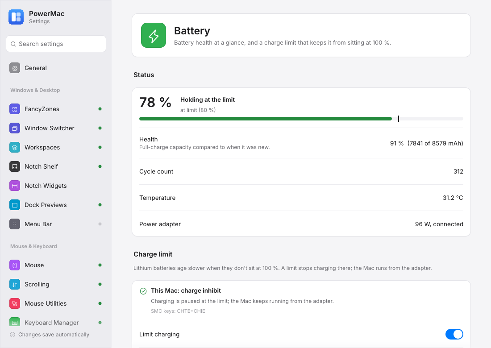

# Battery

Battery health at a glance, and a charge limit that keeps a MacBook's battery from sitting at 100 % (AlDente-style).

Crate: `crates/battery-limit` · Settings page: **Battery** (Displays & Power) · Config: `batteryLimit` · the limit is off by default

<figure markdown="span">
  { loading=lazy }
  <figcaption>Health, the strategy this Mac allows with its trade-offs, and macOS's own Charge Limit.</figcaption>
</figure>

## Status

Percentage, charging state, adapter and wattage, cycle count, health (full-charge vs design capacity), temperature and time remaining — read without any privileges. The tray shows **Battery · 82 %** with the same details and *Charge to 100 % now*.

## Charge limit

Before you turn anything on, the page shows **how this Mac can enforce a limit** and what that means:

| Strategy | When | What happens |
|---|---|---|
| **charge inhibit** | `CHTE` or `CH0B`/`CH0C` is usable | charging pauses at the limit; the Mac runs from the adapter |
| **firmware charge range** | `bfD0`/`bfE0`/`bfF0` | the battery firmware stops at the limit and resumes below the sailing threshold, also during sleep (with *keep the limit while sleeping*) |
| **limit via discharge** | no inhibit key, but the adapter can be switched (`CHIE`; Apple Silicon on macOS 27) | at the limit the adapter is switched off and the Mac runs from the battery until it is below the sailing threshold. Shallow cycles between the two thresholds; the adapter is always switched back on before sleep, on quit and if PowerMac stops responding; never below 20 % |
| unavailable | nothing usable | no limit (use System Settings → Battery → Charge Limit) |

Options: stop charging at (20–100 %), sailing (let it drop before charging again), discharge down to the limit, heat protection (pause charging above a temperature), keep the limit while the Mac sleeps, limit via discharge (fallback), and **Charge to 100 % now** (once, until unplugged).

### macOS Charge Limit

macOS 26.4 and later have their own 80–100 % limit (System Settings → Battery). The page shows whether it is set (read with `pmset -g battlimit`) and opens Battery settings; PowerMac never changes it. When both are set, the lower limit wins.

## The privileged helper

Writing the SMC needs root, so a small LaunchDaemon does the writes for the app. It is shipped in `PowerMac.app/Contents/MacOS/powermac-battery-helper` and **only installed when you click Install helper…** on the Battery page (one administrator prompt; **Uninstall…** removes it). Nothing installs automatically.

| | |
|---|---|
| Label | `com.powermac.battery-helper` |
| Binary | `/Library/PrivilegedHelperTools/com.powermac.battery-helper` |
| Plist | `/Library/LaunchDaemons/com.powermac.battery-helper.plist` |
| Socket | `/var/run/com.powermac.battery-helper.sock` (only the installing user may connect) |
| Log | `/var/log/com.powermac.battery-helper.log` |

Stopping the module (or quitting PowerMac) hands charging back to the firmware.

## Settings

| Key | Default |
|---|---|
| `enabled` | false — nothing is ever written while off |
| `limitPercent` | 80 |
| `sailingPercent` | 5 |
| `dischargeToLimit` | false |
| `heatProtectionCelsius` | 35 (0 = off) |
| `keepLimitDuringSleep` | false |
| `limitViaDischarge` | true |
| `pollSeconds` | 30 (5–600) |

## How it works

The controller always runs in the app (status only while the limit is off) and writes `battery-status.json` every 5 s; the settings window asks for *Charge to 100 %* / *Refresh* through `battery-request.json`. While PowerMac isn't running the page reads the battery and the SMC scheme itself. `policy::step` is a pure, unit-tested state machine (limit, sailing, heat, discharge, top-up, sleep).

## Windows

Status only. Charge thresholds on Windows laptops are vendor tools (Lenovo Vantage, MyASUS, Dell Power Manager, Surface UEFI), so PowerMac never changes anything there.
