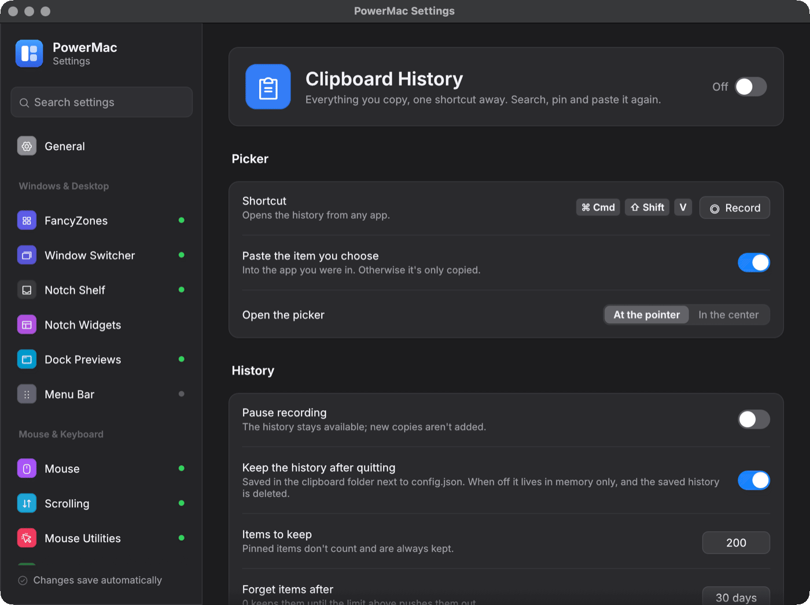

# Clipboard History

Everything you copy — text, rich text, images and files — searchable in a picker, like Maccy or Windows' Win+V.

Crate: `crates/clipboard-history` · Settings page: **Clipboard History** · Config: `clipboardHistory` · off by default

<figure markdown="span">
  { loading=lazy }
  <figcaption>The Clipboard History settings page.</figcaption>
</figure>

## Using it

- **Cmd+Shift+V** (Win+Shift+V on Windows) opens the picker. Type to search, pick an item to paste it into the app that was in front.
- Pin items to keep them forever.
- The tray lists the 10 most recent items, and has Pause and Clear.
- `powermac clipboard` opens the picker from a script.

## Privacy

- Items marked `org.nspasteboard.ConcealedType`, `TransientType` or `AutoGeneratedType` (password managers set these) are never read past their type list. On Windows, `ExcludeClipboardContentFromMonitorProcessing` and `CanIncludeInClipboardHistory = 0` are honoured.
- Copies made while an excluded app is in front are skipped. Default list: 1Password, Bitwarden, KeePassXC, Keychain Access, Passwords.
- Recording can be paused, and history can be kept in memory only (`persist: false`).

## Settings

| Key | Default | Meaning |
|---|---|---|
| `enabled` | false | record history |
| `hotkey` | Cmd+Shift+V | opens the picker (empty disables) |
| `maxItems` | 200 | unpinned items kept |
| `maxAgeDays` | 30 | unpinned items older than this are removed (0 = never) |
| `persist` | true | keep history across restarts |
| `paused` | false | stop recording temporarily |
| `captureImages`, `captureFiles`, `captureRichText` | true | what is recorded |
| `maxItemMb` | 20 | skip bigger items |
| `excludedApps` | password managers | bundle id, name or exe |
| `skipConcealed` | true | honour "don't record" markers |
| `pasteOnSelect` | true | paste, or only copy |
| `pickerPosition` | at the pointer | where the picker opens |

## How it works

- macOS has no clipboard notification, so a worker polls `NSPasteboard.changeCount` every 300 ms and reads the contents only when it changes. Windows uses `AddClipboardFormatListener`.
- Storage: `clipboard/index.json` plus `clipboard/blobs/`, written atomically. Copying the same thing again moves it to the top.
- The picker is an egui window in its own process. It talks to the service in the tray app over loopback TCP; without a running app it reads the files directly.
