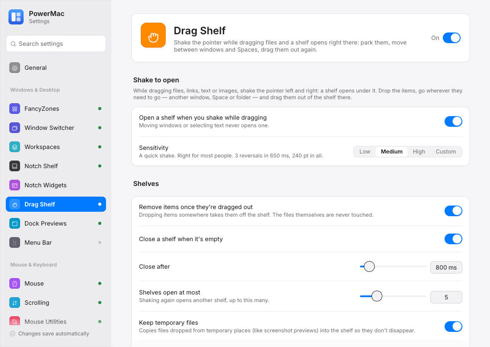
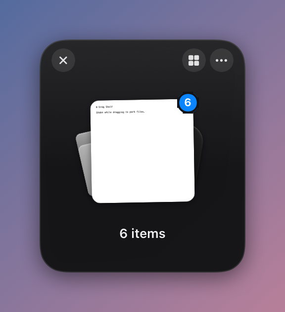
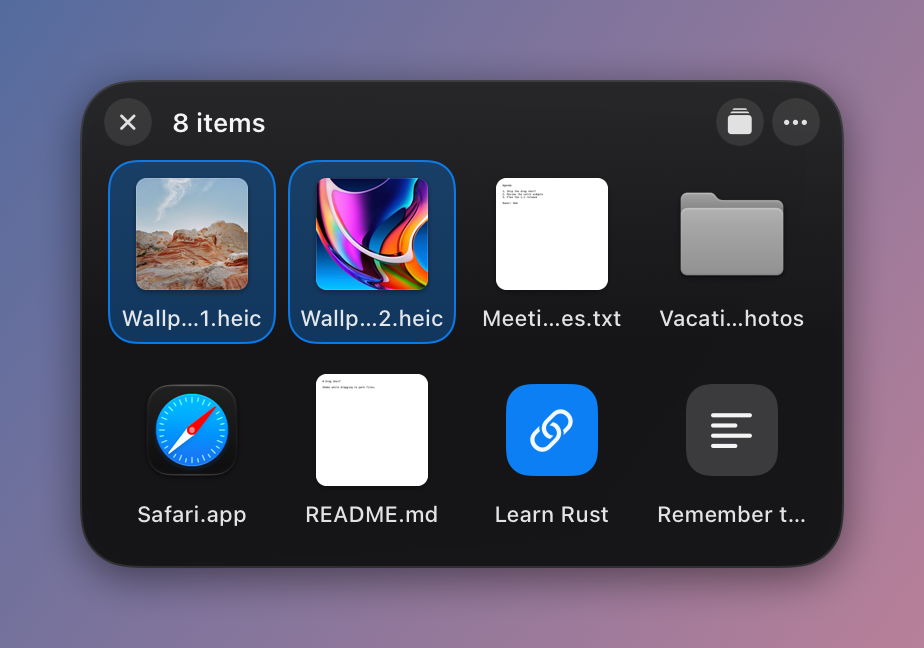
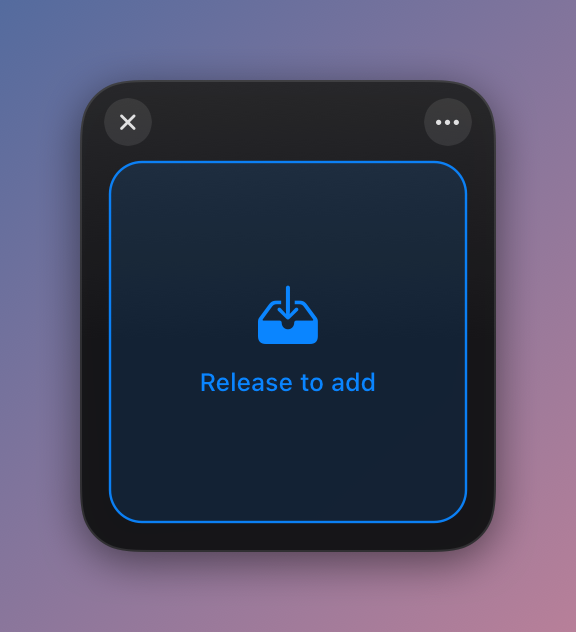

# Drag Shelf

Dropover-style floating shelves: while dragging files, shake the pointer and a small shelf opens right under it. Drop the files on it, go wherever they need to go — another window, another Space, a folder deep in Finder — and drag them out of the shelf there.

Crate: `crates/drag-shelf` (shared shelf code in `crates/pm-shelf-core`) · Settings page: **Drag Shelf** (Windows & Desktop) · Config: `dragShelf` · macOS only

<figure markdown="span">
  { loading=lazy }
  <figcaption>The Drag Shelf settings page.</figcaption>
</figure>

<div class="grid" markdown>

{ loading=lazy width="260" }
{ loading=lazy width="420" }
{ loading=lazy width="260" }

</div>

## Opening a shelf

- **Shake while dragging** (on by default): start dragging files, links, text or images, then move the pointer quickly left and right a few times. A shelf springs open under the pointer, so you only have to let go.
- **Tray → New drag shelf** opens an empty shelf at the pointer.
- **A shortcut** (none by default) does the same from anywhere; set it on the settings page.

Shaking only counts during a drag that carries something a shelf takes. Macs don't announce drags, so PowerMac watches the drag pasteboard: a drag source writes its items there, which bumps its change count. While the button is held, a changed count with files, URLs, text, images or file promises on it means a real drag; moving a window, selecting text or holding the button somewhere does nothing. The input hook only observes (it never swallows a drag event), and shaking over a shelf that is already there just drops on that one.

### Sensitivity

A shake is a number of horizontal reversals within a time window, each after a stroke of a minimum length, adding up to a minimum distance. The movement must be mostly horizontal (circles and scribbles don't count) and much longer than the strip it stays in (the travelled-distance test of Find My Mouse).

| Level | Reversals | Within | Shortest stroke | Distance |
|---|---:|---:|---:|---:|
| Low | 4 | 700 ms | 50 pt | 400 pt |
| Medium (default) | 3 | 650 ms | 35 pt | 240 pt |
| High | 2 | 600 ms | 22 pt | 120 pt |
| Custom | your own (`customShake`) | | | |

## Using a shelf

- The items show as a **fanned stack** of Quick Look thumbnails (links as a tile with their host, text as a note) with a count badge and a caption ("6 items · 2 images · 3 files · 1 folder").
- **Drag the stack** to drag everything out at once, to any app or folder.
- **Click the stack** (or the grid button) to spread it into a **grid**; drag one tile, or ⌘/⇧-click several, to take just those. Double-click opens an item; the × on a hovered tile removes it.
- **The ··· button / right-click**: Copy to… and Move to… a folder (a folder chooser; names that are taken get " 2", links become `.webloc` files and text `.txt` files), Open, Show in Finder, Copy, Share… (AirDrop, Messages, …), Remove, Clear Shelf, Close Shelf.
- **Drop more** on a shelf at any time; drag items from one shelf onto another to move them.
- **Move a shelf** by dragging its background. Shelves are on every Space and over full-screen apps, and never take the keyboard focus from the app you're in.
- **Several shelves** can be open at once (`maxShelves`, 5 by default).
- With **Remove items once they're dragged out** (on by default) a successful drop elsewhere takes the items off the shelf, and an emptied shelf closes after `autoCloseDelayMs`. The files themselves are never moved or deleted by dragging.
- Files dropped from temporary places (screenshot previews, `/var/folders`, caches) are copied into the shelf's folder so they don't vanish.
- Shelves that hold items when PowerMac quits come back at the next start, where they were.

## Settings

```json
"dragShelf": {
  "enabled": true,
  "shakeToOpen": true,
  "sensitivity": "medium",
  "customShake": { "reversals": 3, "windowMs": 650, "minSegmentPx": 35, "minDistancePx": 240 },
  "removeAfterDragOut": true,
  "autoClose": true,
  "autoCloseDelayMs": 800,
  "hotkey": { "win": false, "ctrl": false, "alt": false, "shift": false, "code": 0 },
  "maxShelves": 5,
  "copyTemporaryFiles": true,
  "haptics": true
}
```

| Key | Default | Meaning |
|---|---|---|
| `enabled` | `true` on macOS | The module |
| `shakeToOpen` | `true` | Shake during a drag opens a shelf |
| `sensitivity` | `medium` | `low`, `medium`, `high` or `custom` |
| `customShake` | Medium's values | Thresholds for `custom` (reversals 1–10, window 100–3000 ms, stroke 4–400 pt, distance 10–4000 pt) |
| `removeAfterDragOut` | `true` | Dropping items elsewhere takes them off the shelf |
| `autoClose`, `autoCloseDelayMs` | `true`, 800 | Close emptied shelves after this long |
| `hotkey` | none | Opens an empty shelf at the pointer (`win` is Cmd, `alt` is Option, `code` a virtual-key code) |
| `maxShelves` | 5 | Shelves open at once (1–20) |
| `copyTemporaryFiles` | `true` | Keep copies of files from temporary places |
| `haptics` | `true` | Trackpad tick when a shelf opens and when items land |

Older config files without `dragShelf` load with these defaults.

## Files

- `drag-shelves/index.json`: the open shelves (id, position, grid or stack).
- `drag-shelves/<id>/items.json`: a shelf's items, in the same format as the notch shelf's (`pm_shelf_core::store`).
- `drag-shelves/<id>/files/`: copies of temporary files and images dropped without a file. A closed shelf's folder is deleted at the next start, never right away (a copy that was just dragged out may still be being read).

## Permissions

Accessibility, for the shared input hook (shake detection and the shortcut). Without it, shelves still open from the tray.

## How it fits together

- Shake detection is a passive `pm_hook` subscriber at priority `DRAG_SHELF` (250); the optional shortcut subscribes at `DRAG_SHELF_HOTKEY` (430). See [Global input hook](../architecture/input-hook.md).
- The detector runs on the hook thread; a detected shake (and every button release, to remember the drag pasteboard's count) is handed to the main thread, which checks the drag and opens the panel.
- Panels are borderless non-activating `NSPanel`s (`canJoinAllSpaces | fullScreenAuxiliary`, level 20: above normal windows and palettes, below the menu bar) drawn with Core Animation, in the Notch Shelf's style.
- The item model, drop parsing (files, URLs, text, images, file promises), Quick Look thumbnails, drag-out writers, Open / Show in Finder / Copy, the share picker and the layer helpers are shared with the Notch Shelf through `crates/pm-shelf-core`.

## Windows

Not supported yet: the config loads, the module stays off, and Settings → General → Permissions & Health shows "not supported on Windows" if it is switched on.

## Diagnostics

`cargo run -p drag-shelf --example drag_shelf_demo -- --render DIR` opens sample shelves and renders them offscreen in several states (one file, many fanned, grid, drop targets, a status message). `--live DIR` runs an end-to-end check in a test window of its own (it drags a text snippet, shakes and drops it on the shelf that opens; the pointer is put back); it refuses to run while the screen is locked.
