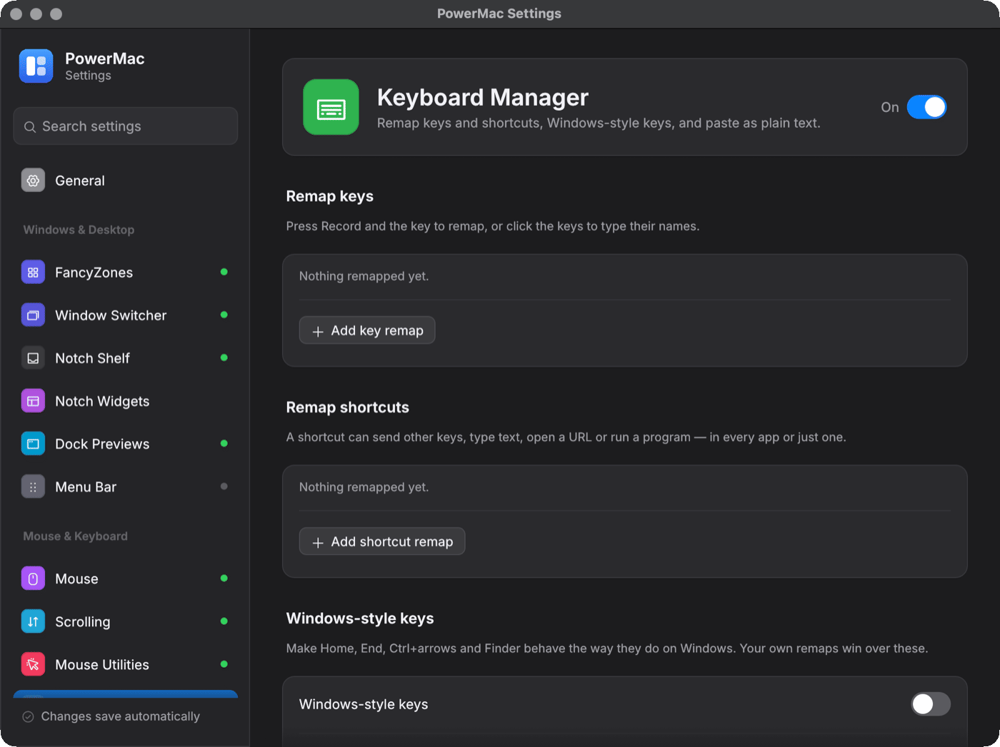

# Keyboard Manager

A port of PowerToys Keyboard Manager, plus Paste as plain text, Windows-style keys and a Hyper key.

Crate: `crates/keyboard-manager` · Settings page: **Keyboard Manager** · Config: `keyboardManager`

<figure markdown="span">
  { loading=lazy }
  <figcaption>The Keyboard Manager settings page.</figcaption>
</figure>

## Features

- **Key remaps:** one key to another key (CapsLock → Esc, swap Option and Command), to a shortcut, to text, or to nothing.
- **Shortcut remaps:** a shortcut to another shortcut (Ctrl+Left → Option+Left), a key, nothing, text, a program or a URL — optionally only in one app.
- **Paste as plain text:** **Cmd+Option+Shift+V** (Win+Ctrl+Alt+V on Windows) strips the clipboard to plain text and pastes it, optionally putting the rich contents back afterwards.
- **Windows-style keys** (macOS, off by default): Home/End, PageUp/PageDown, Ctrl+Arrow word jumps, Ctrl+Backspace/Delete, optional Ctrl+C/V/X/Z/… → Cmd, and in Finder: Cmd+X then Cmd+V moves files, Return opens, F2 renames, Delete trashes, Backspace goes up.
- **Hyper key** (off by default): Caps Lock held = Ctrl+Option+Shift+Cmd (or Control); tapped alone = Escape, nothing or Caps Lock. Or simply Caps Lock = Escape.
- **Import:** a PowerToys Keyboard Manager `default.json` can be converted.

## Config example

```json
{
  "enabled": true,
  "remapKeys": [
    { "from": "CapsLock", "to": "Esc" },
    { "from": "F13", "to": "Cmd+Shift+4" },
    { "from": "F14", "to": { "text": "Kind regards,\nAda" } }
  ],
  "remapShortcuts": [
    { "from": "Ctrl+Left", "to": "Option+Left" },
    { "from": "Ctrl+C", "to": "Cmd+C", "app": "com.microsoft.VSCode" },
    { "from": "Ctrl+Alt+T", "to": { "run": { "path": "/System/Applications/Utilities/Terminal.app" } } },
    { "from": "Ctrl+Alt+G", "to": { "openUri": "https://github.com" } }
  ],
  "pastePlainText": { "enabled": true, "hotkey": "Cmd+Option+Shift+V", "restoreClipboard": false },
  "windowsStyle": { "enabled": true, "ctrlShortcutsToCmd": false },
  "hyperKey": { "mode": "hyper", "tapAction": "escape", "tapTimeoutMs": 200 }
}
```

### Keys and shortcuts

- Keys are Windows virtual-key codes: a number (`20`), hex (`"0x14"`) or a name (`"CapsLock"`, `"F13"`, `"Left"`, `"Numpad5"`, `";"`, `"VolumeUp"`).
- The same config works on both platforms: **Cmd is the Windows key** and **Option is Alt**. `Ctrl`, `Shift`, `Alt`/`Option`, `Win`/`Cmd` mean either side; prefix `L`/`R` for one side.
- Shortcuts are `"Mod+Mod+Key"` strings: one or more modifiers plus one key. They match only with exactly those modifiers held.

### Targets (`to`)

| JSON | Meaning |
|---|---|
| `"Esc"`, `27`, `"LCtrl"` | a single key |
| `"Cmd+C"`, `["Ctrl","C"]` | a shortcut |
| `"disabled"`, `null` | swallow it |
| `{"text": "..."}` | type text (`\n` presses Return) |
| `{"run": {"path", "args", "workingDir"}}` | start a program |
| `{"openUri": "..."}` | open a URL, file or folder |
| `"pastePlainText"` | paste as plain text |

`app` matches the front app's bundle id, name or executable (case-insensitive). App-specific remaps win over global ones.

## How it works

A platform-independent state machine follows PowerToys' `KeyboardEventHandlers.cpp`. On macOS an active `CGEventTap` rewrites events in place or swallows them and posts replacements, fixing modifier flags while a remap changes the modifier state. Caps Lock remaps use `hidutil` and are put back on stop. Windows uses `WH_KEYBOARD_LL` and `SendInput`.

## Limitations

No two-step chords and no PowerToys "alone" remaps. CapsLock works as a tap only on macOS.
