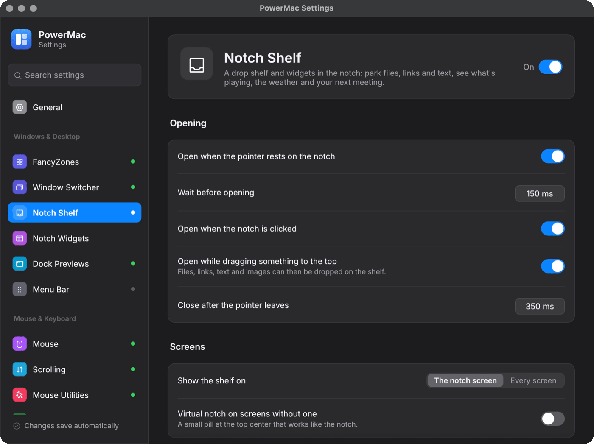

# Notch Shelf and widgets

Turns the MacBook notch into a drop shelf and a small dashboard, in the spirit of NotchNook, Dropover and Yoink.

Crate: `crates/notch-shelf` · Settings page: **Notch Shelf** · Config: `notchShelf`

<figure markdown="span">
  { loading=lazy }
  <figcaption>The Notch Shelf settings page.</figcaption>
</figure>

## The shelf

- Collapsed, the panel is a black shape exactly over the notch, so it's invisible.
- It opens when the pointer rests on the notch, when you click it, or when you drag files, links, text or images near the top of the screen.
- Dropped items become tiles with Quick Look thumbnails. Drag them out to any app, open them, reveal them in Finder, share them (AirDrop, …) or remove them.
- Files dropped from temporary locations (screenshot previews, `/var/folders`, caches) are copied into the shelf's own folder so they survive.
- The shelf is saved in the data folder and survives restarts.
- Macs without a notch can get a "virtual notch" pill at the top center (`virtualNotchOnNonNotchScreens`).

## Home view widgets

The open notch has a Home view next to the shelf: pages of widget cards — Now Playing, Calendar, Weather, Battery, System Stats, Timer, Quick Controls, Note, Mirror, Script, xbar plugins, Web / JSON, Shortcuts, Launcher, Bluetooth batteries, Sound, Reminders and World Clocks. Each card is an instance with its own size, page and settings, and kinds can be added several times.

They're edited on the **Notch Widgets** settings page (tray → **Notch widgets…**): a pages manager, a gallery of every kind, a settings form per widget with a **Test** run for Script / Web / xbar, and layout export / import. See [Notch widgets](notch-widgets.md) for every kind, the script output formats, xbar plugins and the Web template syntax.

`liveActivities` shows music, a running timer and widgets with *Live activity* on beside the collapsed notch. `batteryIndicator` briefly widens the notch with the battery level when the charger is connected or disconnected. `showClipboard` adds the current clipboard item as the first tile (may trigger macOS's paste prompt).

## Settings

| Key | Default |
|---|---|
| `enabled` | true on Macs with a notch |
| `expandOnHover`, `hoverDelayMs`, `collapseDelayMs` | true, 150, 350 |
| `expandOnDrag`, `expandOnClick` | true |
| `screens` | notch only |
| `copyTemporaryFiles` | true |
| `removeAfterDragOut` | false |
| `haptics` | true |
| `panelWidth` | 620 |
| `defaultView` | last used |
| `liveActivities` | true |
| `pages`, `widgets` | one "Home" page with Now Playing, Battery, Timer and Quick Controls (see [Notch widgets](notch-widgets.md)) |

## Platforms

- **macOS:** a borderless, non-activating `NSPanel` above the menu bar on every Space and over full-screen apps, drawn with Core Animation.
- **Windows:** a top-center layered window that slides down when files are dragged to the top center of the primary monitor (OLE drop target and drag source).
