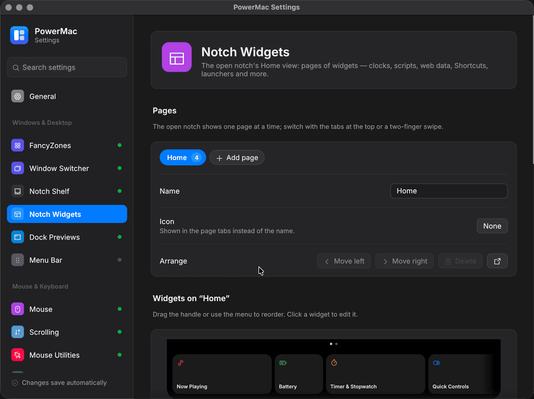

# Notch widgets

The open notch has a **Home view**: pages of widget cards next to the drop shelf. Each card is a *widget instance* — a kind (World Clocks, Script, Web / JSON, …), a size, the page it's on and its own settings. You can add the same kind several times (three scripts, two clock widgets) and lay them out on as many pages as you like.

Settings page: **Notch Widgets** (Windows & Desktop) · Tray: **Notch widgets…** · CLI: `powermac settings --page notch-widgets` · Config: `notchShelf.widgets`, `notchShelf.pages`

<figure markdown="span">
  { loading=lazy }
  <figcaption>The Notch Widgets settings page: pages, and a live preview of the Home view.</figcaption>
</figure>

The widget platform is macOS-only. On Windows the shelf has no Home view, but the settings page still edits, imports and exports layouts.

## The settings page

- **Pages** — tabs for each Home page with its widget count. Rename a page, give it an icon (shown in the notch's tabs instead of the name), move it left or right, delete it (its widgets move to the neighbouring page; the last page can't be deleted), or add a new one. With PowerMac running, the arrow button opens the notch on that page.
- **Widgets on a page** — a to-scale picture of the page as the notch shows it (click a card to edit it), then the widgets in order. Drag the handle to reorder, pick a size (only the sizes the kind supports), switch a widget off (it keeps its settings), or use **⋯** to move it up / down, to another page, duplicate or delete it.
- **Add widget** opens the **gallery**: every kind grouped by category (Build your own, Information, Media, System, Tools) with its sizes, a description and what it needs (a permission, a network service). Click one to add it to the current page with its default settings.
- **Editor** — click a widget to edit it. The form comes from the kind's settings schema; problems are shown under each field (and as a warning on the widget's row) while you type. Tokens are hidden unless you click the eye. Commands, plugin paths, URLs and templates are applied when you leave the field, so a half-typed command never runs. Helpers:
    - **Shortcuts**: an **Add shortcut** menu with your shortcuts (read with `shortcuts list`; nothing is run).
    - **Launcher**: an app menu for app items and a folder button for files / folders.
    - **World Clocks**: a menu of common time zones (any IANA name works).
    - **Reminders**: your lists, once the running widget has read them.
    - **xbar Plugins**: the plugin folder, the plugins in it with their refresh intervals, and **Open plugins folder**.
    - **Script, Web / JSON, xbar**: **Test** runs the widget once in the background and shows the card it would draw (or the error). Nothing runs until you click it. With PowerMac running, the latest result from the notch is shown too, and the refresh button re-runs it there.
- **Home view** — what the notch opens in (last view, widgets, shelf) and **Live activities** (music, a running timer and widgets with *Live activity* on, shown beside the closed notch).
- **Share layout** — export and import (see below).

Everything saves automatically; the running app applies widget and page changes live.

<figure markdown="span">
  { loading=lazy }
  <figcaption>The page preview, the widget list and the gallery that <strong>Add widget</strong> opens.</figcaption>
</figure>

## Sizes and pages

Cards are all the same height. A **small** card is one unit wide (136 pt), **medium** two, **large** three. Cards on a page sit in one row; when they're wider than the panel (up to 940 pt) the row scrolls sideways. Switch pages with the tabs / dots at the top of the panel or a two-finger swipe; the last page is remembered.

## Widget kinds

| Kind | Sizes | What it shows | Needs |
|---|---|---|---|
| Now Playing | M L | track, artwork, progress, controls | Automation for Music / Spotify only with *Read Music and Spotify directly* |
| Calendar | M L | next events (`days`, `calendars`) | Calendars access |
| Weather | S M | conditions, high / low from Open-Meteo (`location`, `units`) | network (no account) |
| Battery | S M | level, time remaining | — |
| System Stats | M L | CPU, memory, network sparklines | — |
| Timer & Stopwatch | M L | countdown presets (`presets`, minutes) and a stopwatch | — |
| Quick Controls | S M L | PowerMac's toggles and actions (`controls`: `awake`, `pick-color`, `extract-text`, `clipboard`, `switcher`, `lock`, `desktop`; empty = all) | — |
| Note | S M L | a scratchpad (each note keeps its own text) | — |
| Mirror | S M | the camera while you click it | Camera access |
| Script | S M L | your command's output as text, a number with a gauge, a list or JSON | runs your command |
| xbar Plugins | S M L | xbar / SwiftBar / BitBar plugins: title and menu items | runs your plugins |
| Web / JSON | S M L | values picked from a JSON API with a template | network |
| Shortcuts | S M L | buttons that run Apple Shortcuts, optionally with their text output | the shortcuts may ask for their own permissions |
| Launcher | S M L | a grid of apps, files, folders, links and commands | — |
| Bluetooth Batteries | S M L | AirPods (left / right / case), Magic Mouse / Keyboard / Trackpad and other devices | — |
| Sound | M L | output device switcher, volume, mute (PowerMac's audio control) | — |
| Reminders | M L | incomplete reminders (`lists`, `show`); tick one to complete it | Reminders access |
| World Clocks | S M L | times elsewhere (`clocks: [{zone, label}]`, `style` digital / analog, `hours`, `seconds`) | — |

Calendar, Reminders and Camera are asked for the first time the widget is shown (Reminders needs `NSRemindersFullAccessUsageDescription` in the app's Info.plist, which `scripts/bundle-macos.sh` adds; without it the widget says it isn't available and never prompts).

Data-driven widgets refresh on a schedule (their *Refresh every* setting, with back-off after errors). Refreshing pauses while the notch has been closed for a while, unless the widget feeds a live activity.

## Script widget

The command runs with the chosen interpreter (`zsh` / `bash` login shells by default, `sh`, Python 3, Node.js, Ruby, Perl, AppleScript or a custom path called as `<path> -c <command>`), in the working folder, stopped after the time limit. Only commands you enter in the settings are ever run. The environment has `POWERMAC=1` and `POWERMAC_WIDGET_ID`.

**Output formats** (*Output* setting; *Automatic* picks JSON for an object or array, a number for one or two lines starting with one, otherwise text):

=== "Text"

    The first line is the title, the rest the body.

    ```bash
    echo "Build #482"; echo "passed in 3m 12s"
    ```

=== "Number"

    A value with an optional label and unit, and an optional caption line. A percentage fills the gauge; other numbers use *Minimum* / *Maximum*.

    ```bash
    df -h / | awk 'NR==2 {print "Disk " $5}'      # → Disk 73%
    ```

=== "List"

    One item per line; a tab separates a subtitle, `- ` / `* ` bullets are dropped, `[x]` / `[ ]` are check marks.

    ```bash
    printf 'web-01\tok\nweb-02\tok\n[x] backups\n'
    ```

=== "JSON"

    Everything a card can show:

    ```json
    {
      "title": "Disk", "value": 73, "unit": "%", "progress": 0.73,
      "subtitle": "142 GB free", "sf_symbol": "internaldrive", "color": "#30D158",
      "action": "refresh",
      "items": [
        {"title": "Open Disk Utility", "action": "run:open -a 'Disk Utility'"},
        {"title": "Docs", "subtitle": "web", "action": "https://support.apple.com"}
      ]
    }
    ```

    A bare array is a list of items. Actions are a URL, `run:COMMAND`, `copy:TEXT`, `refresh`, or `{"type": "url" | "run" | "copy" | "refresh", "value": …, "terminal": false, "refresh": true}`.

*When clicked* can refresh, open a URL, run a command or copy the output. *Live activity* shows the value beside the closed notch.

## xbar plugins

The xbar widget runs [xbar](https://xbarapp.com) / SwiftBar / BitBar plugins from a file or a folder — by default `~/Library/Application Support/PowerMac/plugins` (**Open plugins folder** creates it). Plugins must be executable (`chmod +x`). The refresh interval comes from the file name (`cpu.5s.sh`, `prs.10m.py`, `wx.1h.sh`, `x.1d.js`, `fast.500ms.sh`) unless *Refresh every* is set. Plugins are only ever run from that path, as you; only install plugins you trust.

Supported output:

```text
Title line(s)            several lines cycle
---
Item | href=https://example.com color=red sfimage=star.fill
Run me | bash=/path/script param1=a param2="b c" terminal=false refresh=true
--Submenu item           one "--" per level
---                      separator
```

Parameters: `href`, `bash` / `shell` with `param1…`, `terminal`, `refresh`, `color`, `font`, `length`, `trim`, `alternate`, `dropdown`, `disabled`, `checked`, `emojize`, `ansi`, `image` / `templateImage` (base64), `sfimage`, `key`. Plugins see `XBARDarkMode=true`, `BitBarDarkMode=1` and `OS_APPEARANCE=Dark` (the notch is always dark).

## Web / JSON widget

Fetches a URL (HTTPS only unless *Allow plain HTTP* is on; no user name / password in the URL), with optional headers (`Name: value`) and an API token sent as *Token header* with *Token prefix* (`Authorization: Bearer …` by default). The token is stored in PowerMac's config and left out of exports. Fetched content is never run.

**Templates** — *Value*, *Subtitle*, *List item* and *Open when clicked* are text with `{{path}}` placeholders:

- Paths: `data.price`, `data.items[0].name`, `list[-1]` (from the end), `items[*].name` (every element), `prices.length()`, `$["key with spaces"]`. A non-JSON response is `{{body}}`.
- Filters follow a bar and can be chained: `{{data.amount | round:2 | prefix:$}}`

| Filter | Example | Result |
|---|---|---|
| `round:N` / `fixed:N` | `{{3.14159 \| round:2}}` | `3.14` |
| `int` | `{{7.9 \| int}}` | `7` |
| `abs` | `{{-4 \| abs}}` | `4` |
| `upper`, `lower`, `trim` | `{{name \| upper}}` | `ADA` |
| `default:X` | `{{city \| default:Unknown}}` | `Unknown` when missing or empty |
| `join:SEP` | `{{tags \| join: · }}` | `a · b · c` (`, ` by default) |
| `len` | `{{items \| len}}` | length of an array, object or text |
| `first`, `last` | `{{list \| first}}` | an array's first / last element |
| `percent[:N]` | `{{0.425 \| percent:1}}` | `42.5%` (numbers above 1 are already percent) |
| `bytes` | `{{1536000 \| bytes}}` | `1.5 MB` |
| `date[:short]`, `time` | `{{updated \| date}}` | `Oct 26, 14:05` (Unix seconds / milliseconds or ISO 8601) |
| `prefix:X`, `suffix:X` | `{{eta \| prefix:ETA }}` | only when the value isn't empty |

*Gauge value* is a path to a number shown as a ring between *Gauge minimum* and *maximum*; *List* is a path to an array rendered with *List item*. Links opened on click must be http(s).

Example — Bitcoin price from Coinbase:

| Setting | Value |
|---|---|
| URL | `https://api.coinbase.com/v2/prices/BTC-USD/spot` |
| Value | `{{data.amount \| round:0}} {{data.currency}}` |
| Symbol | `bitcoinsign.circle` |

## Layout export and import

**Share layout** on the settings page saves the pages and widgets to a JSON file (`~/Downloads/notch-layout.json` by default; **Choose…** picks another place). API tokens and other secrets are left out unless **Include API tokens** is on — only use that for your own backups.

```json
{
  "format": "powermac.notch.layout",
  "version": 1,
  "pages": [{"name": "Home", "symbol": "house.fill"}, {"name": "Dev"}],
  "widgets": [
    {"id": "…", "kind": "worldClock", "size": "medium", "page": 0, "enabled": true,
     "settings": {"clocks": [{"zone": "Asia/Tokyo", "label": "Tokyo"}], "style": "analog"}}
  ]
}
```

**Import** either replaces the current layout or adds the file's pages after yours. Settings are checked and repaired, widgets of unknown kinds are skipped, and ids that collide with yours are renewed; what was fixed is listed as warnings. **Undo import** puts the previous layout back. A bare `widgets` array and the old `[{kind, enabled}]` format are accepted too.

## Config

```json
"notchShelf": {
  "pages": [{"name": "Home", "symbol": "house.fill"}, {"name": "Work"}],
  "widgets": [
    {"id": "4f0c…", "kind": "script", "size": "medium", "page": 1, "enabled": true,
     "settings": {"command": "df -h / | awk 'NR==2 {print $5}'", "title": "Disk", "interval": 300}}
  ],
  "defaultView": "last",
  "liveActivities": true
}
```

Configs from before the widget platform (`widgets: [{kind, enabled}]` with global `weather` / `calendar` / `nowPlaying` settings) are migrated when read, keeping the order, the on / off state and those settings.
