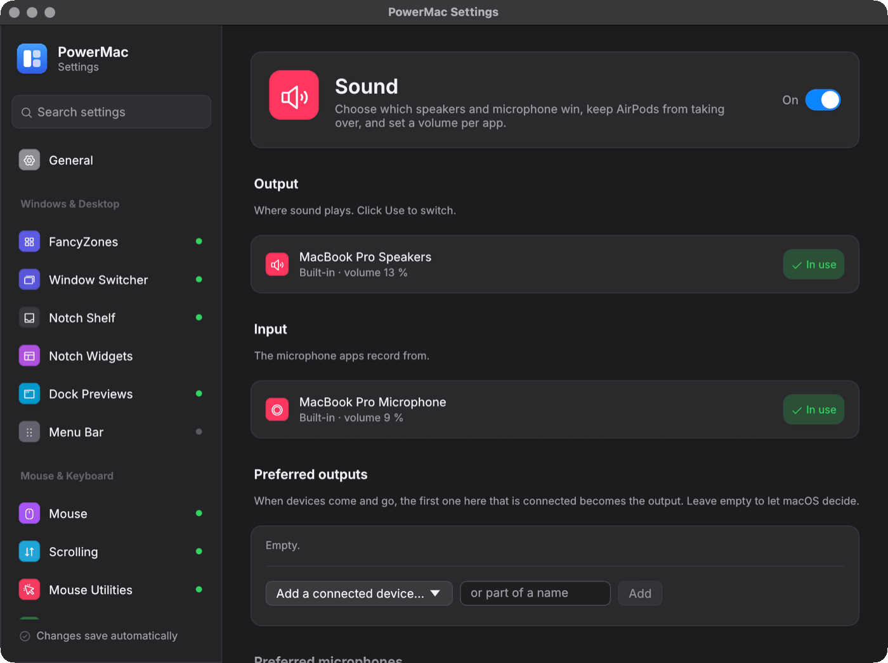

# Sound

Default-device rules, device volume and mute, and per-app volume.

Crate: `crates/audio-control` · Settings page: **Sound** · Config: `audio`

<figure markdown="span">
  { loading=lazy }
  <figcaption>The Sound settings page.</figcaption>
</figure>

## Features

- **Devices:** list outputs and inputs with name, transport, volume and mute; set the default output, input and alert device from Settings or the tray.
- **Priority rules:** a ranked list of preferred outputs and inputs. When devices appear or disappear, the highest-ranked available one becomes the default.
- **Never auto-switch to:** devices (AirPods, …) the OS may not switch to on its own. If it does, PowerMac reverts it within ~50 ms. Choosing the device yourself still works.
- **Keep the built-in mic with Bluetooth headphones**, so they stay in high-quality (A2DP) mode.
- **Per-app volume:** macOS 14.4+ through Core Audio process taps (experimental, off by default, needs the audio capture permission). Windows uses audio sessions natively. Levels are saved in `appVolumes`, keyed by bundle id or exe name.

## Settings

| Key | Default |
|---|---|
| `enabled` | true |
| `rules` | empty |
| `blockAutoSwitchTo` | [] |
| `keepBuiltinMicWithBluetooth` | false |
| `perAppVolume` | false |
| `appVolumes` | {} |

## How it works

macOS: hand-bound CoreAudio. Windows: the MMDevice API, `IPolicyConfig` and audio sessions. The settings window reads `audio-status.json` (every 2 s) and writes `audio-request.json` (polled every 150 ms). Per-app taps are removed when the module stops.

## Virtual audio device (PowerMac Audio)

A Core Audio HAL driver, like BlackHole: **PowerMac Audio** appears as both an output and an input, and whatever apps play to it can be recorded from it. You can add more devices next to it, such as "PowerMac Mix 1".

- 2, 8, 16, 32 or 64 channels at 44.1, 48 or 96 kHz, float32, no latency or safety offset (the clock follows the host clock exactly).
- An output volume and mute control, so the volume keys work while it is the output.
- Up to 16 devices. They are added, removed and renamed live. Changing a device's channel count or sample rate briefly stops IO on that device only. The sample rate can also be set in Audio MIDI Setup.

Crate: `crates/pm-audio-driver` (Rust `cdylib` + `rlib`). Installer and configuration: `audio_control::driver`.

### Build

```bash
./scripts/build-audio-driver.sh            # target/release/PowerMac Audio.driver
CHECK=1 ./scripts/build-audio-driver.sh    # …and load it in-process with the fake host
UNIVERSAL=1 ./scripts/build-audio-driver.sh
```

The bundle is signed with `SIGN_IDENTITY` if set (Developer ID, hardened runtime). Otherwise it uses the local **PowerMac Local Signing** identity if it is in the keychain, or ad-hoc signing.

### Install

Settings → Sound → **Virtual audio device** → Install…. The page first warns that **installing restarts Core Audio, so all sound stops for a few seconds**, and asks you to confirm. It then runs one administrator prompt (`osascript … with administrator privileges`). That step copies the bundle to `/Library/Audio/Plug-Ins/HAL` (owned by root) and runs `killall coreaudiod`, and launchd starts Core Audio again. Uninstall works the same way. From code: `audio_control::driver::{install(bundle), uninstall(), installed_version(), status(), find_bundled_driver()}`.

### Configuration

The device set is JSON (`DriverConfig`: `devices: [{uid, name, channels, sampleRate}]`). It lives in a custom property (`'pmcf'`, a CFString) on the driver's plug-in object, and the driver saves it in Core Audio's plug-in storage. `audio_control::driver::{read_config, write_config}` read and write it through `kAudioHardwarePropertyTranslateBundleIDToPlugIn`. No reinstall is needed.

### How it works

- **Loopback.** Each device has a ring of 16384 frames. WriteMix stores the mix at its output sample time, and ReadInput reads at the input sample time. Frames that were never written (or were overwritten) read as silence, and a pause in playback leaves a silent gap rather than replaying old audio.
- **Clock.** Zero timestamps are spaced one ring (16384 frames) apart, anchored at StartIO, and use `mach_timebase_info` ticks per frame.
- **Real-time rules.** The IO path doesn't allocate or call the host. Every entry point catches panics, and host callbacks run only after locks are released.

### Tests

`cargo test -p pm-audio-driver` covers the ring buffer, clock math, volume curve, config validation, ABI struct sizes (against the SDK headers) and every property table. It also drives the driver through its vtable with a **fake host**: configuration changes, `RequestDeviceConfigurationChange`/`Perform…`, StartIO and bit-exact loopback. `tests/load_bundle.rs` puts the crate's own dylib into a `.driver` bundle and loads it through **CFPlugIn**, the way coreaudiod does, then runs the same checks. None of this installs anything.
