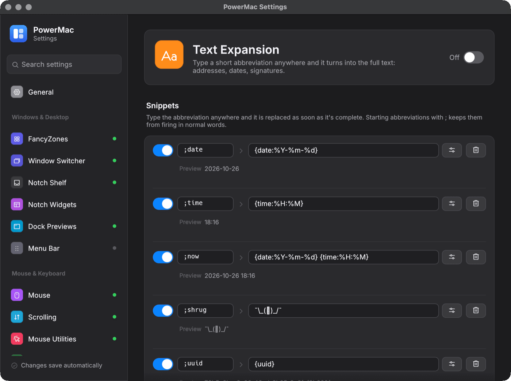

# Text Expander

Type an abbreviation anywhere (`;addr`, `:date`, `btw`) and it is replaced with its snippet, like TextExpander or espanso.

Crate: `crates/text-expander` · Settings page: **Text Expansion** · Config: `textExpander` · off by default

<figure markdown="span">
  { loading=lazy }
  <figcaption>The Text Expansion settings page.</figcaption>
</figure>

## Behaviour

- A snippet expands as soon as its trigger's last character is typed, or with `wordBoundary` when a space, Return, Tab or punctuation follows a trigger that starts a word.
- **Backspace** right after an expansion undoes it (`undoWithBackspace`).
- `caseSensitive: false` matches any case and carries it over: `;Addr` capitalizes, `;ADDR` upper-cases.
- Snippets can be limited to apps (`apps`). Password managers are excluded by default, terminals optionally (`excludeTerminals`), and nothing is read while macOS secure input is on.
- espanso match files can be imported.

## Variables

| Variable | Result |
|---|---|
| `{date}`, `{date:%d.%m.%Y}` | current date |
| `{time}`, `{time:%H:%M:%S}` | current time |
| `{clipboard}` | clipboard text |
| `{cursor}` | where the caret ends up |
| `{uuid}` | a random UUID |
| `{random:6}`, `{random:10-99}` | random digits / number |
| `{{`, `}}` | literal braces |

## Config example

```json
{
  "enabled": true,
  "snippets": [
    { "trigger": ";date", "replacement": "{date:%Y-%m-%d}" },
    { "trigger": "btw", "replacement": "by the way", "wordBoundary": true, "caseSensitive": false },
    { "trigger": ";sig", "replacement": "Best,\nAda", "apps": ["com.apple.mail", "outlook.exe"] },
    { "trigger": ";div", "replacement": "<div>{cursor}</div>" }
  ],
  "pasteThreshold": 200,
  "clipboardRestoreDelayMs": 400
}
```

## How it works

A rolling buffer of typed characters is reset by clicks, navigation keys, Cmd/Ctrl shortcuts and focus changes. When a trigger completes, the completing key is swallowed, the rest is deleted with Backspaces, and the replacement is typed as unicode key events — or pasted through the clipboard (saved and restored) when longer than `pasteThreshold`. On macOS this is a session-level `CGEventTap` reading `CGEventKeyboardGetUnicodeString`, so any keyboard layout works. Windows uses low-level hooks, `ToUnicodeEx` and `SendInput`.
