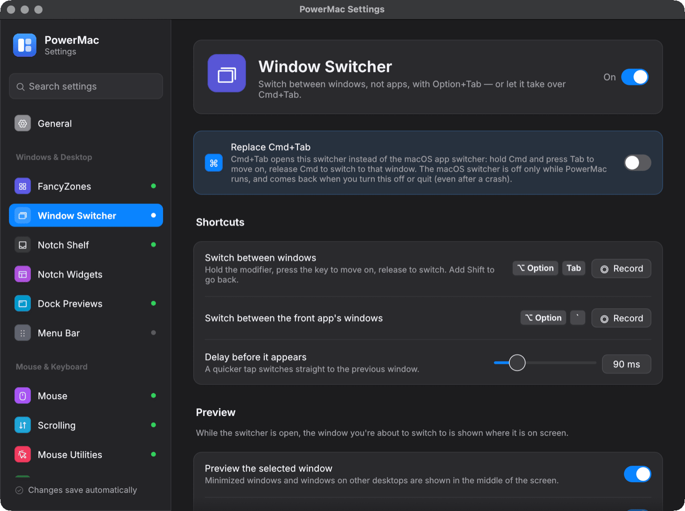
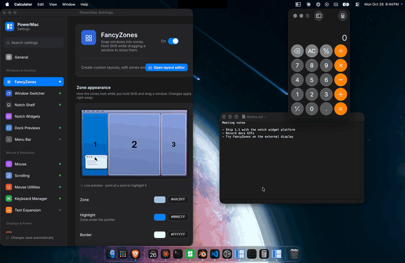

# Window Switcher

A Windows-style Alt+Tab for macOS: hold a modifier, press Tab to cycle through **windows** (not apps) in most-recently-used order, release to switch.

Crate: `crates/window-switcher` · Settings page: **Window Switcher** · Config: `windowSwitcher`

<figure markdown="span">
  { loading=lazy }
  <figcaption>The Window Switcher settings page.</figcaption>
</figure>

<figure markdown="span">
  { loading=lazy }
  <figcaption>Hold the modifier and press Tab to move through the windows, release to switch. Each window has a live thumbnail, and the selected one is shown where it is on screen with the rest dimmed. Without Screen Recording permission you get app icons and outlines instead.</figcaption>
</figure>

## Shortcuts

| Shortcut | Action |
|---|---|
| **Option+Tab** | all windows |
| **Option+\`** | windows of the front app (Alt+\` on Windows) |
| **Cmd+Tab** / Cmd+Shift+Tab | all windows, with **Replace Cmd+Tab** on or when Cmd+Tab is the switcher's shortcut (Option+Tab keeps working as a second shortcut) |
| Cmd+\` | windows of the front app, with Replace Cmd+Tab and `replaceCmdBacktick` on or when Cmd+\` is the front-app shortcut |

### Replacing Cmd+Tab

Turn on **Replace Cmd+Tab** at the top of the Window Switcher settings page, or set the switcher's shortcut to Cmd+Tab; both take over the macOS app switcher (the page says so under the shortcut). Setting the front-app shortcut to Cmd+\` takes over macOS's "Move focus to next window" the same way. Hold Cmd and press Tab to move on, release Cmd to switch; Esc cancels, and Cmd+Q / W / M / H act on the *selected* window (like AltTab). The macOS app switcher is turned off only while PowerMac's keyboard hook works: it comes back when you turn the option off, quit PowerMac, the hook is disabled or fails, or Secure Input (a password field) is active. If PowerMac crashes, the next start (of any PowerMac) turns it back on — a marker file in `$TMPDIR` records what was turned off. If the AltTab app is running with the same shortcut, the settings page warns about it.

If Cmd+Tab suddenly shows the macOS app switcher (apps instead of windows), PowerMac has handed it back. The log (`~/Library/Logs/PowerMac/powermac.log`) says why: usually an app turned on Secure Input because a password field has focus, and the log names that app. Cmd+Tab switches windows again once the field loses focus.

### Which windows are listed

Every standard window and dialog of every app, PowerMac's own Settings window included, one entry per window. Minimized windows, windows of hidden apps and windows on other Spaces are listed unless turned off below. Windows an app has closed but keeps in the background (Calendar does this) are not, just as on Windows. To see the list the switcher would show right now:

```bash
powermac switcher-windows          # add --app for the front app's windows only
```

### Preview of the selected window

While the switcher is open, the selected window is shown at its real position and size, above every other window and below the switcher, with the rest of the screen dimmed (`dimOpacity`, 25 %). Minimized windows, windows of hidden apps and windows on other desktops are shown in the middle of the screen with a badge. The image is the cached thumbnail at first and a full-resolution capture a moment later. Without Screen Recording the preview is an outline of the window with its app icon and title.

While the switcher is open:

| Key | Action |
|---|---|
| Tab / Shift+Tab (modifier held) | next / previous window |
| arrows, mouse hover | move the selection |
| release the modifier, Return, Space, click | switch to the selected window |
| Esc, click outside | cancel |
| Q / W / M / H / F | quit app / close window / (un)minimize / (un)hide app / full screen |

A tap-and-release quicker than `showDelayMs` (90 ms) switches to the previous window without showing the overlay.

## Settings

| Key | Default | Meaning |
|---|---|---|
| `enabled` | true | master switch |
| `trigger` | Option+Tab | all-windows shortcut (unset on Windows) |
| `appWindowsTrigger` | Option+\` | front-app windows shortcut |
| `replaceCmdTab` | false | also take over Cmd+Tab / Alt+Tab (automatic when `trigger` is Cmd+Tab) |
| `replaceCmdBacktick` | false | macOS, with `replaceCmdTab`: Cmd+\` opens the front app's windows (automatic when `appWindowsTrigger` is Cmd+\`) |
| `previewSelectedWindow` | true | show the selected window on screen while the switcher is open (macOS) |
| `dimBackground` | true | dim the rest of the screen behind the preview |
| `dimOpacity` | 0.25 | how dark the dimming is (0–0.85) |
| `showMinimized`, `showHidden`, `showOtherSpaces` | true | which windows are listed |
| `onlyCurrentScreen` | false | only windows on the screen with the pointer |
| `thumbnails` | true | live thumbnails (needs Screen Recording; app icons otherwise) |
| `showDelayMs` | 90 | hold time before the overlay appears |
| `excludedApps` | [] | bundle ids, app names or exe names |

## How it works

- Pure logic (MRU order, filtering, key state machine, tile grid) is unit-tested.
- **macOS:** an active `CGEventTap`; windows are enumerated through Accessibility and CGWindowList (other Spaces through the private CGS APIs AltTab uses); thumbnails via ScreenCaptureKit; the overlay is an `NSPanel` with `NSVisualEffectView`; the preview is a second click-through, non-activating panel just below it. The system switcher is turned off with `CGSSetSymbolicHotKeyEnabled` (hotkeys 1 and 2; 6 and 27 for Cmd+\`).
- **Windows:** low-level hooks, `EnumWindows` with Alt+Tab rules, DWM live thumbnails.
