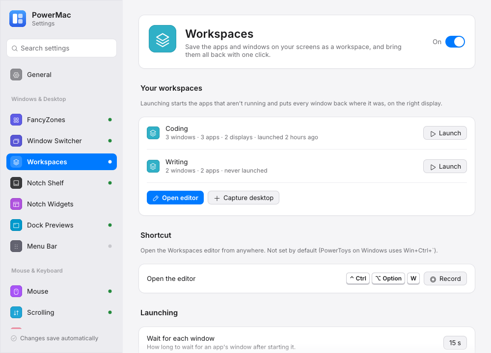

# Workspaces

PowerToys **Workspaces** for the Mac: save the apps and windows on your screens as a named workspace and bring them all back later — PowerMac starts what isn't running, waits for the windows and puts each one where it was, on the right display.

<figure markdown="span">
  { loading=lazy }
  <figcaption>Settings → Workspaces: the saved workspaces with Launch buttons, the editor shortcut and the capture / launch options.</figcaption>
</figure>

## Using it

| Where | What |
|---|---|
| Menu bar icon → **Workspaces** | One item per workspace (click to restore it), **Capture desktop…**, **Edit workspaces…** |
| Settings → **Workspaces** | The list with **Launch** buttons, **Open editor**, **Capture desktop**, and the settings below |
| The editor | Cards with a preview of each workspace; edit, rename, remove apps, change a window's display / frame / state, desktop shortcuts, import PowerToys' `workspaces.json` |
| A shortcut | Opens the editor (none by default; set one on the settings page — PowerToys on Windows uses Win+Ctrl+\`) |
| Command line | `powermac workspace list \| capture [NAME] \| launch NAME\|ID \| edit` |

**Capture desktop…** saves the current windows as "Workspace N" and opens the editor so you can name it and remove what doesn't belong. Restoring runs in the background; a notification reports the result ("Coding: 3 placed, 1 skipped").

## What is saved

- Every visible window (minimized ones too, unless turned off): app, frame, display, state (normal, maximized, minimized, full screen) and, where the private Space API reports it, its Space.
- The open document of document-based apps (TextEdit, Preview, Pages, …) when **Remember open documents** is on.
- The front tab's address of browsers when **Remember browser tabs** is on. macOS asks once per browser to let PowerMac control it (Automation).
- Never PowerMac itself, and never the apps in **Never capture**.

Command-line arguments of running apps aren't captured on macOS (GUI apps are started by LaunchServices, which doesn't pass them). Apps are never quit: "other windows" can only be minimized or hidden.

## Settings (`config.json` → `workspaces`)

| Setting | Default | |
|---|---|---|
| `enabled` | on | The module (tray submenu, shortcut, launching) |
| `hotkey` | none | Opens the editor; `{"win","ctrl","alt","shift","code"}` like PowerToys (`win` is Cmd, `alt` is Option, `code` a Windows VK code) |
| `launch.timeoutSecs` | 15 | How long to wait for an app's window |
| `launch.missingMonitor` | `scaleToPrimary` | A window saved on a display that's gone: scaled onto the main display, or `primaryMinimized` (PowerToys' behaviour) |
| `launch.activateFirst` | on | Bring the first app forward at the end |
| `launch.restoreSpaces` | off | Move windows back to their Space (private API; may not work on recent macOS) |
| `capture.includeMinimized` | on | |
| `capture.documents` | on | |
| `capture.browserUrls` | off | Needs Automation permission per browser |
| `capture.excludedApps` | `[]` | Bundle ids, app names or `.exe` names |
| `shortcutKind` | `app` | Desktop shortcuts: a small app or a `.command` file (macOS) |

The workspaces themselves are in `workspaces.json` next to `config.json` (PowerToys' format, so files can be moved between the two).

## Permissions

Reading and moving other apps' windows needs **Accessibility** — the same permission FancyZones uses. Without it, launching and capturing show a notification pointing to Settings → General. No Screen Recording is needed: previews are drawn from rectangles and app icons.

## How the pieces talk

The settings window never moves windows itself: **Launch**, **Capture desktop** and **Open editor** write an `AppRequest` to `app-request.json` and the running app does the work (with its Accessibility grant). Without a running app, the settings window starts `powermac workspace …` instead. The shortcut is a subscription to the shared input hook (`pm_hook`, priority 440); it appears in the global shortcut registry, so the settings window won't let another module take the same keys.
