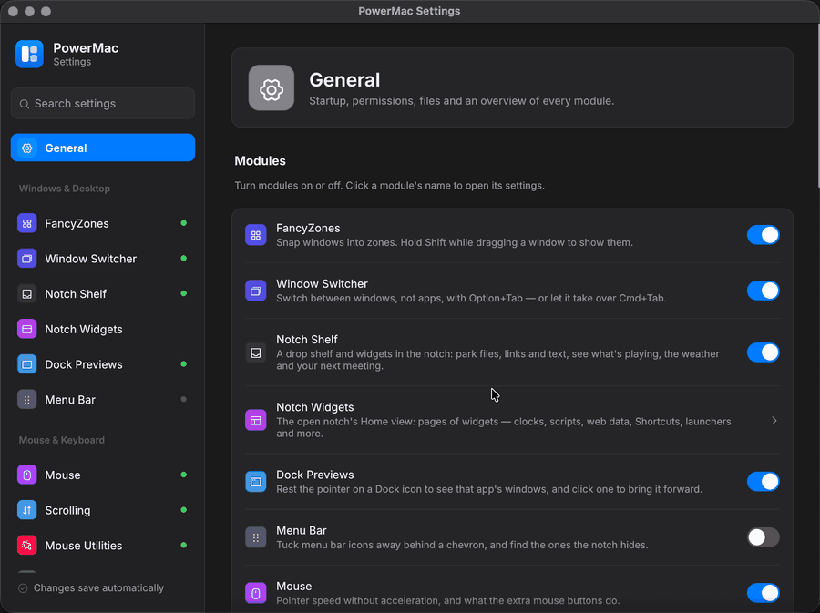

# Install and first run

## Requirements

| | macOS | Windows |
|---|---|---|
| OS | macOS 11 Big Sur or later (some modules need newer, noted on their pages) | Windows 10/11 (compile-checked only) |
| CPU | Apple Silicon recommended; Intel works except DDC/CI monitor control | x86_64 |
| Toolchain | Rust stable (`rustup`), Xcode Command Line Tools | Rust stable, MSVC build tools |

## Download

Get `PowerMac-<version>-macos-<arch>.dmg` from the [Releases page](https://github.com/finepointcgi/PowerMac/releases) (`arm64` for Apple Silicon, `universal` for any Mac), open it and drag PowerMac onto **Applications**.

### Opening a build that isn't notarized

PowerMac isn't notarized by Apple (that needs a paid developer account), so the first time you open it on a Mac macOS says it can't check it for malicious software. To open it anyway:

1. Open PowerMac once and click **Done** in the warning.
2. Open **System Settings → Privacy & Security** and scroll down to the **Security** section: there is a line saying PowerMac "was blocked to protect your Mac".
3. Click **Open Anyway**, confirm with your password or Touch ID, and click **Open**.

macOS remembers this; later launches open normally. (In Terminal, `xattr -dr com.apple.quarantine /Applications/PowerMac.app` does the same.) Updates are offered in the app, see [Updates](updates.md).

## Package a disk image

```bash
./scripts/package-dmg.sh
```

builds the bundle (below) and writes `$CARGO_TARGET_DIR/PowerMac-<version>-macos-<arch>.dmg` with the app and an Applications link, signs it with the local identity when there is one, verifies it and prints its SHA-256 (also in `….dmg.sha256`). `UNIVERSAL=1` makes a universal image, `SKIP_BUILD=1` packages an existing bundle, `FANCY=1` adds a background with an arrow (it lays out the window with Finder through AppleScript, so macOS asks once to let Terminal control Finder).

## Build the app bundle (macOS)

```bash
./scripts/bundle-macos.sh
```

The script builds `powermac` in release mode and wraps it in `target/release/PowerMac.app` (it honours `CARGO_TARGET_DIR`). The app is menu-bar only: `LSUIElement` is set, so it has no Dock icon. Move it to `/Applications` and open it:

```bash
mv target/release/PowerMac.app /Applications/
open /Applications/PowerMac.app
```

### Keeping permissions across rebuilds

macOS ties Accessibility, Input Monitoring and Screen Recording grants to the app's code signature. An ad-hoc signature changes on every build, so the grants reset each time. To avoid that, create a stable local signing identity once:

```bash
./scripts/create-signing-cert.sh
```

This adds a self-signed **PowerMac Local Signing** certificate to your login keychain (macOS asks for your password). From then on `bundle-macos.sh` signs with it and the grants survive rebuilds.

!!! note "Distribution builds"
    The local certificate is for development. Builds for other people need a Developer ID certificate and notarization; see [Production readiness](../production-readiness.md).

## Run from the command line

```bash
cargo build --release
./target/release/powermac            # all enabled modules + tray icon
```

When run from a terminal, macOS attributes permissions to the terminal app, not to PowerMac. Use the bundle for everyday use. The [command line reference](cli.md) lists every subcommand.

## First launch

1. PowerMac creates `config.json` with defaults and a fresh **Mouse Without Borders security key** (see [Configuration files](configuration.md)).
2. The **setup** opens: what PowerMac is, which feature groups to turn on, the permissions those need (with live status, buttons for the right System Settings panes and a **Restart PowerMac** button), and the shortcuts of what you chose. Skipping or closing it is remembered; **Setup & permissions…** in the menu brings it back. See [Permissions](permissions.md#the-setup-window).
3. A menu-bar icon appears. Its menu has **Settings…**, **Setup & permissions…** (with a **⚠ Needs …** line and a dot on the icon while a permission is missing, and **Update available** when there is one), Awake modes, Workspaces, FancyZones layouts, scroll direction, mouse utilities, Paste as plain text, Copy security key, Launch at login, and a **Tools** section (Pick color, Extract text, Clipboard history, Window switcher, Show shelf, Displays presets, Finder Quick Actions).
4. Modules whose permission is missing wait for it; the rest keep running. Open **Settings → General** to see each permission's status, with buttons that open the right System Settings pane. [Permissions](permissions.md) explains which module needs what.
5. Run `powermac doctor` at any time to print the config location, permission status and detected screens.

<figure markdown="span">
  { loading=lazy }
  <figcaption>The settings window: one page per module in the sidebar, and a search across every setting.</figcaption>
</figure>

## Launch at login

Turn it on from the tray (**Launch at login**) or **Settings → General**.

## Logs

When PowerMac isn't attached to a terminal it logs to:

- macOS: `~/Library/Logs/PowerMac/powermac.log`
- Windows: `%LOCALAPPDATA%\PowerMac\powermac.log`

The log rotates to `powermac.log.old` at 5 MB. Set `RUST_LOG=debug` for more detail.

## Uninstall

1. Quit PowerMac from its menu.
2. If you installed the Finder Quick Actions, remove them in **Settings → File Tools** (or delete the `PowerMac — …` workflows in `~/Library/Services`).
3. Delete the app and, to remove all settings and history, `~/Library/Application Support/PowerMac/`.
4. Remove PowerMac from the Privacy & Security lists in System Settings.
