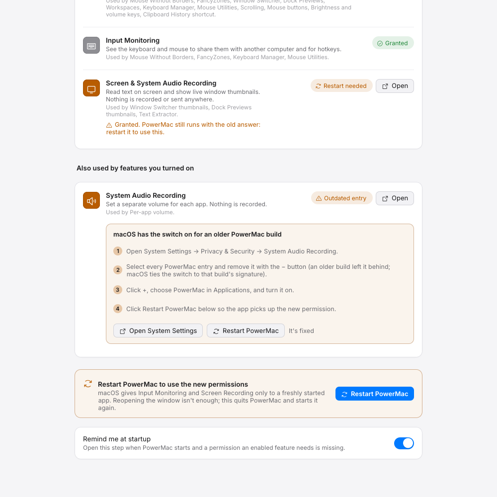

# Permissions (macOS)

Many modules watch or change global input, move other apps' windows or capture the screen, which macOS only allows after you grant a permission in **System Settings → Privacy & Security**. PowerMac asks for nothing it doesn't use: a permission matters only if a module that needs it is on.

| Permission | Needed by |
|---|---|
| **Accessibility** | Mouse Without Borders, FancyZones, Scrolling, Mouse Utilities, Keyboard Manager (and its automation hotkeys), Text Expander, Window Switcher, Dock Previews, Menu Bar Manager, Clipboard History's hotkey, mouse button mappings, keeping bound trackpad clicks from apps, Displays' brightness/volume keys |
| **Input Monitoring** | Mouse Without Borders, FancyZones, Mouse Utilities, Keyboard Manager |
| **Screen Recording** | Text Extractor (screen capture), Window Switcher and Dock Previews thumbnails, Menu Bar Manager's floating bar on macOS 15 and older. Without it these fall back to app icons; OCR of files and clipboard images still works. |
| **Automation (Finder)** | Finder basics acting on the front Finder window without a selection (opt-in). |
| **Automation (Music, Spotify)** | Notch Shelf's Now Playing widget when `useAppleScript` is on (opt-in). |
| **System Audio Recording** | Sound's per-app volume (experimental, macOS 14.4+), app routing and app sources in the mixer. |
| **Microphone** | Microphone and audio-interface sources in the Sound mixer (asked the first time the mixer opens one). |
| **Calendars** | Notch Shelf's Calendar widget. |
| **Reminders** | Notch Shelf's Reminders widget. |
| **Camera** | Notch Shelf's Mirror widget. |
| **Administrator password (once)** | Installing a display override plist; installing the battery charge-limit helper (only from Settings → Battery → Install helper…); installing the PowerMac Audio driver (Settings → Sound). |
| none | Color Picker, Notch Shelf's shelf, Displays sliders, pointer speed/acceleration, File Tools, Awake |

## The setup window

The first time PowerMac starts it opens a short setup (**Welcome → Choose features → Permissions → Done**; `powermac settings --page welcome`). Its Permissions step — also **Settings → General → Permissions & Health**, `powermac settings --page permissions`, and the menu bar icon's **Setup & permissions…** — has one row per permission:

- why PowerMac asks for it and which of the features you turned on use it;
- the live state, refreshed every second;
- **Open**, which opens exactly that pane of System Settings, and **Request…** where macOS has a prompt for it (Accessibility, Input Monitoring, Screen Recording, System Audio Recording);
- the optional permissions (System Audio Recording, Calendars, Reminders, Camera, Automation) only when a feature you turned on needs them.

<figure markdown="span">
  { loading=lazy }
  <figcaption>Granted, granted but waiting for a restart, and an outdated entry with the steps to fix it.</figcaption>
</figure>

When a permission an enabled feature needs is missing at startup, PowerMac opens that step again (turn **Remind me at startup** off to stop that) and the menu bar icon gets a dot and a **⚠ Needs …** line.

| Pane | URL |
|---|---|
| Accessibility | `x-apple.systempreferences:com.apple.preference.security?Privacy_Accessibility` |
| Input Monitoring | `…?Privacy_ListenEvent` |
| Screen & System Audio Recording | `…?Privacy_ScreenCapture` |
| System Audio Recording | `…?Privacy_AudioCapture` |
| Calendars / Reminders / Camera | `…?Privacy_Calendars` / `…?Privacy_Reminders` / `…?Privacy_Camera` |
| Automation | `…?Privacy_Automation` |

These were checked against macOS 27.2: System Settings' Privacy & Security extension (`com.apple.settings.PrivacySecurity.extension`) still accepts the `com.apple.preference.security` URL scheme and lists every one of these anchors.

## Restart after granting

macOS hands **Input Monitoring** and **Screen Recording** (and System Audio Recording) only to a freshly started process: a running PowerMac keeps the old answer, and reopening the settings window doesn't help. The setup notices — a permission that a fresh `powermac permissions --json` reports as granted while the running app (in `app-status.json`) still doesn't have it shows **Restart needed** — and its **Restart PowerMac** button quits the app cleanly and starts it again with `open -n` of the bundle; the settings window comes back on the same page.

## Outdated entries

Grants are tied to the code signature. After installing a build signed differently (an ad-hoc build, a rebuild without the local certificate, a downloaded release after a local build), the switch in System Settings can be on for the *old* PowerMac while the new one still isn't allowed. When you say "Turned it on, but it still says Not granted?", the row shows the fix:

1. Open System Settings → Privacy & Security → the permission.
2. Select every PowerMac entry and remove it with **−**.
3. Click **+**, choose PowerMac in Applications and turn it on.
4. Restart PowerMac.

To avoid this while developing, run `scripts/create-signing-cert.sh` once (see [Install](install.md#keeping-permissions-across-rebuilds)).

## Other ways to see the status

- **Settings → General → Permissions & Health** also shows the shared input hook (healthy, listen-only, disabled by macOS; slow handlers) and one line per module: running, waiting for a permission, didn't start, or off.
- `powermac permissions` lists each permission, its state and the features that use it (`--json` for scripts); `powermac doctor` prints the overall state and `powermac doctor --prompt` asks macOS for the missing ones.

## Windows

Windows needs no grants for low-level hooks. Note that hooks don't receive input aimed at elevated (administrator) windows unless PowerMac itself runs elevated.
