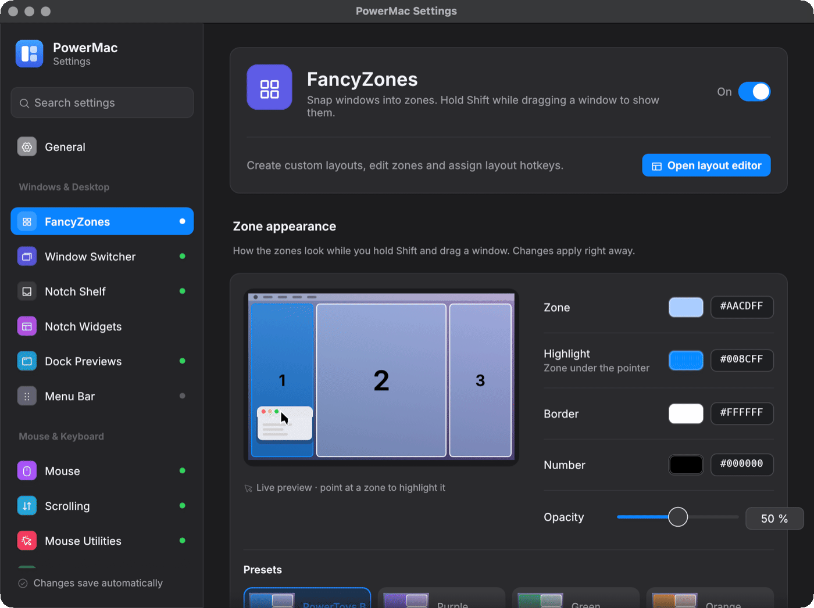
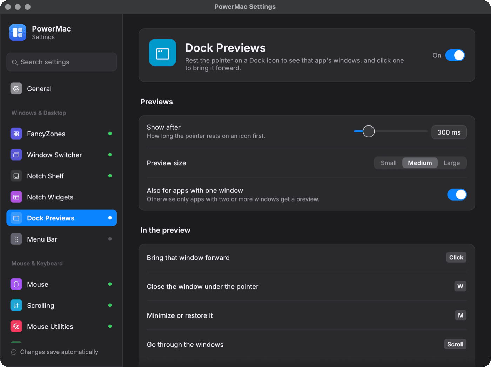
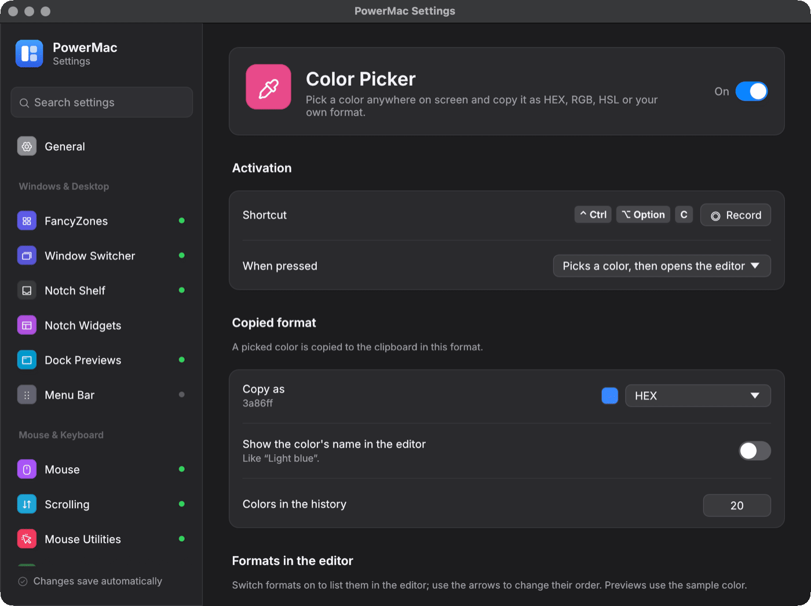
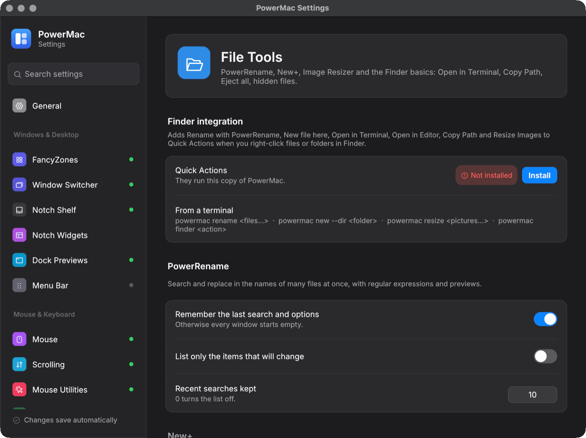
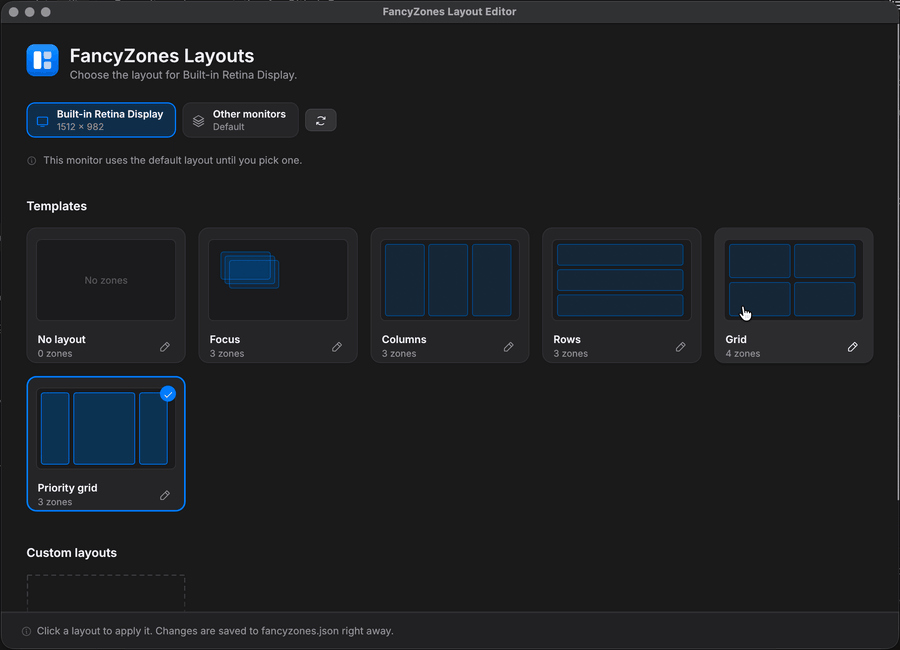

# PowerMac

PowerMac brings PowerToys-style utilities to **macOS** (and, compile-checked, to **Windows**) in one Rust app. It lives in the menu bar on macOS and the notification area on Windows. A settings window configures it, and every module can be switched on or off on its own.

It started as a port of Microsoft PowerToys and grew to cover the gaps people hit when they move to a Mac: window snapping, a window-based Alt+Tab, Dock previews, sensible mouse behaviour, external-monitor brightness, HiDPI on non-Retina screens and more.

!!! info "Version 1.0.0"
    Download the latest macOS build from the [Releases page](https://github.com/finepointcgi/PowerMac/releases). The Windows backends compile but have **not** been run on Windows yet, so no Windows build is published. See [Production readiness](production-readiness.md) for what is still open.

<figure markdown="span">
  
  <figcaption>One settings window for every module: switch pages from the sidebar or search across all settings.</figcaption>
</figure>

## What it does

| Area | Modules |
|---|---|
| **Windows and desktop** | [FancyZones and edge snapping](features/fancyzones.md) · [Window Switcher](features/window-switcher.md) · [Dock Previews](features/dock-previews.md) · [Menu Bar Manager](features/menu-bar.md) · [Notch Shelf and widgets](features/notch-shelf.md) |
| **Input** | [Mouse Without Borders](features/mouse-without-borders.md) · [Mouse tuning](features/mouse-tuning.md) · [Scrolling](features/scrolling.md) · [Mouse Utilities](features/mouse-utils.md) · [Keyboard Manager](features/keyboard-manager.md) · [Text Expander](features/text-expander.md) |
| **Hardware** | [Displays](features/displays.md) · [Display Scaling](features/display-scaling.md) · [Sound](features/sound.md) · [Awake](features/awake.md) |
| **Tools** | [Clipboard History](features/clipboard-history.md) · [Color Picker](features/color-picker.md) · [Text Extractor](features/text-extractor.md) · [File Tools](features/file-tools.md) (PowerRename, New+, Image Resizer, Finder basics) |

The [feature overview](features/index.md) lists every module with its default state, shortcut and the permissions it needs.

## In action

<div class="shots">
<a href="features/fancyzones/"><span>FancyZones: Shift+drag into a zone</span></a>
<a href="features/window-switcher/"><span>Window Switcher</span></a>
<a href="features/dock-previews/"><span>Dock Previews</span></a>
<a href="features/notch-shelf/"><span>Notch widgets</span></a>
</div>

## A look around

Every module has its own page in the settings window. Click a screenshot to read about the feature.

<div class="shots">
<a href="features/fancyzones/"><span>FancyZones</span></a>
<a href="features/window-switcher/"><span>Window Switcher</span></a>
<a href="features/notch-widgets/"><span>Notch widgets</span></a>
<a href="features/dock-previews/"><span>Dock Previews</span></a>
<a href="features/mouse-without-borders/"><span>Mouse Without Borders</span></a>
<a href="features/keyboard-manager/"><span>Keyboard Manager</span></a>
<a href="features/text-expander/"><span>Text Expander</span></a>
<a href="features/displays/"><span>Displays</span></a>
<a href="features/sound/"><span>Sound</span></a>
<a href="features/clipboard-history/"><span>Clipboard History</span></a>
<a href="features/color-picker/"><span>Color Picker</span></a>
<a href="features/file-tools/"><span>File Tools</span></a>
</div>

<figure markdown="span">
  { loading=lazy }
  <figcaption>The FancyZones layout editor.</figcaption>
</figure>

## Quick start

```bash
git clone https://github.com/finepointcgi/PowerMac.git
cd PowerMac
./scripts/bundle-macos.sh          # builds target/release/PowerMac.app
open target/release/PowerMac.app
```

Then grant the [permissions](getting-started/permissions.md) the modules you want need, and open **Settings…** from the menu-bar icon. [Install and first run](getting-started/install.md) has the details.

## How it is put together

PowerMac is a Cargo workspace of about 25 crates. Each feature is a library crate with a platform-independent, unit-tested core and thin OS backends. The `powermac` binary starts the modules, owns the tray icon and reloads the config file when it changes. The settings window and the other helper windows run as separate processes of the same executable and talk to the app only through JSON files. See [Architecture](architecture/overview.md).
